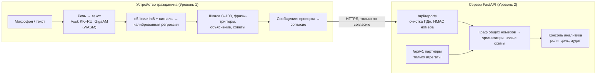

# Qorğan — распознавание телефонного мошенничества на устройстве (GovTech Camp 2026)

> **Демо:** **https://govtech-production.up.railway.app**
> · [проверка звонка](https://govtech-production.up.railway.app/live.html)
> · [кабинет аналитика](https://govtech-production.up.railway.app/admin.html) (на демо открыт без ключа, данные вымышленные)
>
> **Документы для жюри:** [техническая документация](docs/TECHNICAL.md) ·
> [карта пути пользователя (CJM)](docs/CJM.md) · [история по неделям](docs/HISTORY.md) ·
> [English technical reference](docs/TECHNICAL_REFERENCE_EN.md)

**Qorğan замечает приёмы социальной инженерии в телефонном разговоре на казахском, русском и
смешанном языке, пока звонок ещё идёт.** Он показывает шкалу подозрения 0–100, дословные фразы,
которые к ней привели, объясняет оценку и советует, что делать. Добровольные сообщения граждан
он собирает в «организации» мошенников для аналитика. **Решение всегда принимает человек:** система
ничего не блокирует, никуда не сообщает сама и не кладёт трубку.

| | |
|---|---|
| **Где идёт анализ** | на устройстве гражданина: речь распознаётся в браузере, модель (`multilingual-e5-base` int8 + калиброванная регрессия) работает в web worker. Сервер **не принимает аудио** |
| **Языки звонка** | казахский, русский и переключение между ними посреди фразы; язык помечается у каждого слова |
| **Языки интерфейса** | казахский, русский, английский |
| **Что уходит на сервер** | только сообщение, которое гражданин сам проверил, исправил и отправил с согласием; номер — как HMAC-дайджест, текст — очищенный от ПДн |
| **Каналы** | веб-приложение (PWA), Android-приложение (TWA, собирается), **[предложение]** мини-сервис в eGov Mobile |

---

## Содержание
1. [Задача](#1-задача)
2. [Архитектура](#2-архитектура)
3. [Стек](#3-стек)
4. [Быстрый старт](#4-быстрый-старт)
5. [Структура репозитория](#5-структура-репозитория)
6. [Качество модели](#6-качество-модели)
7. [Тесты](#7-тесты)
8. [Развёртывание](#8-развёртывание)
9. [Приватность](#9-приватность)
10. [Ограничения](#10-ограничения)
11. [Команда](#11-команда)
12. [Документация](#12-документация)

---

## 1. Задача

По официальному сообщению Нацбанка РК от 04.02.2026, на 1 января 2026 года Антифрод-центр
зафиксировал **80 871 инцидент** с признаками мошенничества
([nationalbank.kz](https://www.nationalbank.kz/ru/news/informacionnye-soobshcheniya/18571)). За
январь–ноябрь 2025 года зарегистрировано **26,3 тыс.** правонарушений интернет-мошенничества — рекорд
([informburo.kz](https://informburo.kz/novosti/rekordnoe-kolicestvo-skolko-slucaev-mosennicestva-v-seti-zaregistrirovali-v-kazaxstane-v-2025-godu)).

Существующие меры работают **до** разговора (блокировка номера) или **после** него (антифрод по
транзакции). Сам разговор, в котором человека убеждают, не видит никто. Qorğan работает именно с
**содержанием разговора**: даёт гражданину объяснённое предупреждение во время звонка, а государству —
картину организованных схем, собранную только из добровольных сообщений.

Путь гражданина и аналитика по шагам — в [`docs/CJM.md`](docs/CJM.md).

---

## 2. Архитектура



- **Уровень 1** — статическое PWA в `site/`. Конвейер: распознавание речи → скользящее окно →
  эмбеддинг e5-base (768) ⊕ 5 флагов жёстких сигналов ⊕ 1 флаг успокоения → калиброванная
  логистическая регрессия (риск + 15 тактик) → шкала с гистерезисом 0.59 / 0.49 → дословные
  фрагменты и шаблонные объяснения на kk / ru / en. **Текст языковой модели пользователю не
  показывается.**
- **Уровень 2** — сервер FastAPI, получает только сообщения с согласием (граждане и партнёры),
  связывает их в организации по графу общих номеров, открывает полную расшифровку только
  следователю с указанной целью и записью в HMAC-цепочку аудита.
- **Инварианты** (аудио не принимается, `/api/analyze` ничего не хранит, два входа в Уровень 2,
  номера только как дайджест, очищенные тексты, квитанция + удаление + срок хранения, закрытая
  консоль) закреплены тестами `tests/test_architecture.py`.

Диаграммы контекста, контейнеров, конвейера и потока сообщения, все модули и API —
[`docs/TECHNICAL.md`](docs/TECHNICAL.md).

---

## 3. Стек

| Слой | Технологии |
|---|---|
| Устройство | Vanilla JS (ES-модули), service worker (PWA), transformers.js 3.8.1 + onnxruntime-web (WASM), Vosklet 1.2.1 (Vosk KK 0.42 + RU 0.22), sherpa-onnx 1.13.8 + GigaAM-Multilingual 220M int8 |
| Модель | `Xenova/multilingual-e5-base` int8 ONNX, scikit-learn (калиброванная логистическая регрессия) |
| Сервер | Python 3.11, FastAPI, Uvicorn, Pydantic, ONNX Runtime 1.21 (закреплён под браузер), NetworkX |
| Хранилище | JSONL на томе с атомарной записью (пилот: Postgres) |
| Android | TWA (Bubblewrap), WebView-оболочка (Java), ядро на Kotlin (AAR, onnxruntime-android) |
| Инфраструктура | Docker, Docker Compose, Railway, Hugging Face Hub (модели и корпус при сборке), GitHub Actions |
| Тесты | pytest, Node test runner, Playwright, JUnit |

---

## 4. Быстрый старт

```bash
# 1. Окружение (Python 3.11+)
python3.11 -m venv .venv && source .venv/bin/activate
pip install -e ".[dev]"            # ".[all]" добавляет облачный уровень, Streamlit-стенд, исследования
cp .env.example .env               # задать QORGAN_NUMBER_HMAC_KEY, QORGAN_AUDIT_CHAIN_KEY, QORGAN_ANALYST_KEYS

# 2. Модели и демо-данные (один раз, ~690 МБ): корпус, эмбеддер, Vosk, GigaAM, данные Уровня 2
python scripts/deploy_bootstrap.py

# 3. Сервер: лендинг, проверка звонка, консоль аналитика, OpenAPI
python -m qorgan.api               # http://localhost:8000 · /live.html · /admin.html · /docs

# 4. Тесты
pytest -q && npm install && npm test
```

**Через Docker** (промышленный режим, один контейнер):

```bash
cp .env.example .env && docker compose up -d --build
curl -s localhost:8000/api/health  # {"status":"ok","configured_backend":"linear","threshold":0.59,"linear_model_source":"web"}
```

**Без моделей и ключей** приложение тоже запускается: оно переходит на детерминированный бэкенд
`mock`, и демо-сценарии работают.

**Что показать за 3 минуты** — три сцены из `site/core/scenarios.json` на `live.html`: русский
мошенник (шкала 98/100), казахский мошенник (97/100), настоящий звонок банка (19/100, тревоги нет).
Затем отправить сообщение и найти его в консоли аналитика. Сценарий — [`docs/DEMO_RUNBOOK.md`](docs/DEMO_RUNBOOK.md).

---

## 5. Структура репозитория

```
site/                 продукт: PWA (лендинг, проверка звонка, консоль аналитика)
  core/               модули на устройстве: речь, окно, модель, шкала, объяснения, сообщение, очистка ПДн
  models/weights.json поставляемые веса модели
src/qorgan/           сервер и всё, что общее с обучением
  api*.py             маршруты: анализ, сообщения, консоль аналитика, партнёры
  classifier/         признаки, сигналы, обучение, экспорт весов для браузера
  explain/            объяснения и советы (шаблоны и YAML на ru/kk/en)
  analytics/          граф номеров, организации, приоритет, новые схемы
  reports/ privacy/   хранилище сообщений, срок хранения, HMAC номеров
  audit.py            журнал аудита (HMAC-цепочка)
  data/ eval/         корпус, очистка ПДн, оценка качества
  config.py           все константы и настройки
android/              TWA, WebView-оболочка (как в eGov Mobile), ядро на Kotlin
scripts/              развёртывание, проверка перед показом, публикация, оценка
data/                 таксономия, словари сигналов, происхождение данных
tests/ tests_js/      Python- и JS-тесты, браузерные проверки (Playwright)
docs/                 документация (раздел 12)
app/                  Streamlit — только локальный стенд разработчика, не продукт (ADR D4)
```

---

## 6. Качество модели

Главная метрика — **доля ложных тревог (FPR)**: ложная тревога на настоящем звонке банка разрушает
доверие. Все числа — вывод тестового харнесса на эмбеддингах самого браузера, с 95%
интервалами Клоппера — Пирсона.

**Главная цифра — независимые звонки.** Шесть наборов `shift_local*` (828 звонков) написаны на
нашем ноутбуке локальной казахской моделью другого семейства (ISSAI Qwen3.5-9B-Kazakh), которая не
видела ни корпуса, ни промптов, ни словарей (`scripts/pooled_judges.py`, ADR D76):

| 828 звонков kk + ru | Ложные тревоги [95% ДИ] | Пойманные мошенники [95% ДИ] |
|---|---|---|
| **Все вместе** | **22/417 = 0.053 [0.033, 0.079]** | **187/411 = 0.455 [0.406, 0.505]** |
| Казахский | 16/249 = 0.064 [0.037, 0.102] | 95/248 = 0.383 [0.322, 0.447] |
| Русский | 6/168 = 0.036 [0.013, 0.076] | 92/163 = 0.564 [0.485, 0.642] |

Наборы с общим с обучением генератором (поэтому цифры завышены):

| Набор | FPR [95% ДИ] | Recall [95% ДИ] | N |
|---|---|---|---|
| `test` | 0.000 [0.000, 0.060] | 1.000 [0.957, 1.000] | 143 |
| `authored_heldout` (ручной) | 0.000 [0.000, 0.142] | 0.889 [0.653, 0.986] | 42 |
| `ood` (вне распределения) | 0.000 [0.000, 0.049] | 0.932 [0.813, 0.986] | 118 |
| `shift` (валидация, D65) | 0.000 [0.000, 0.106] | 0.455 [0.281, 0.636] | 66 |

В потоковом режиме тревога срабатывает в среднем на **3-й фразе** (медиана); ложная фиксация — 3/60.
На 47 реальных фразах мошенников из опубликованных приговоров модель признаёт рискованными 29, а
словарь ключевых фраз — только 1: реальная речь ловится смыслом, а не словами (D68).

**Почему модель не обновлялась с сентября.** Шесть переобучений ловили больше мошенников (лучшее —
0.618 на независимом наборе), но начинали тревожить на семейных просьбах о деньгах. Правило
«новая ложная тревога — только на звонке, похожем на учреждение, никогда на семейном» записано
заранее, и ни одно переобучение его не прошло (D63–D76). Методика и все абляции —
[`docs/eval_report.md`](docs/eval_report.md).

---

## 7. Тесты

| Набор | Результат (10.11.2026) |
|---|---|
| `pytest -q` — API, инварианты, приватность, аудит, модель, Docker, Android-упаковка | 1883 пройдено, 2 пропущено, 2 xfail |
| `npm test` — JS-ядро против Python на эталонных фикстурах, страницы, офлайн | 206 / 206 |
| `./gradlew :core:test -PruntimeGate=true` (`android/qorgan-core`) — Kotlin против тех же фикстур | 16 / 16 |
| `tests_js/tools/e2e_*.mjs` — настоящий Chrome: сообщение, i18n, офлайн, голос, консоль | локально (нужны модели) |

CI (`.github/workflows/ci.yml`) запускает `ruff` + `pytest` и `npm test` на каждый push в `main` и pull
request — на чистой копии без корпуса, моделей и секретов.

---

## 8. Развёртывание

| Вариант | Как | Документ |
|---|---|---|
| Docker Compose | один контейнер, без root, ФС только для чтения, секреты из `.env`, состояние на томе; **одна реплика** | [`docs/DEPLOY.md`](docs/DEPLOY.md) |
| Railway (демо) | сборка того же `Dockerfile` из GitHub; три секрета в переменных; проверка `/api/health`; перед показом `python scripts/preflight.py --base <url>` | [`docs/DEPLOY.md`](docs/DEPLOY.md) §8 |
| Android-приложение (TWA) | `bubblewrap update` + `./gradlew bundleRelease`; нужны домен, ключ подписи и его SHA-256 в `site/.well-known/assetlinks.json` | [`android/README.md`](android/README.md) |
| eGov Mobile (WebView) | `android/webview-shell` — оболочка, повторяющая мини-сервис; облегчённый голосовой режим | [`docs/egov/`](docs/egov/README.md) |
| Пилот в РК **[предложение]** | ЦОД в РК, TLS + WAF, Postgres, KMS, WORM-аудит, ШЭП с mTLS, SSO + MFA | [`docs/TECHNICAL.md`](docs/TECHNICAL.md) §10.5 |

Секреты: `QORGAN_NUMBER_HMAC_KEY`, `QORGAN_AUDIT_CHAIN_KEY`, `QORGAN_ANALYST_KEYS` (и
`QORGAN_PARTNER_API_KEYS` для партнёров). Без них сервер закрывает связанные функции. Все параметры —
`.env.example` и `src/qorgan/config.py`.

---

## 9. Приватность

- Аудио не покидает устройство; ни один маршрут сервера его не принимает.
- Сообщение отправляется только после проверки, правки и согласия гражданина. По квитанции его можно
  удалить в любой момент; сервер удаляет его сам через 180 дней.
- Очистка ПДн (номера, в том числе продиктованные словами и с паузами, карты, ИИН, IBAN, e-mail,
  имена) одинакова в Python, JS и Kotlin на 124 эталонных случаях.
- Номер звонившего хранится как HMAC-дайджест + префикс `+7 700 ***`; поиска по номеру нет.
- Полная расшифровка — только роль следователя, указанная цель, 30 открытий в час, запись в журнал
  аудита (HMAC-цепочка, `python -m qorgan.audit verify`) **до** выдачи.
- Облачный уровень (Gemini) выключен по умолчанию и требует согласия на каждый запрос.
- Ни одна страница не обращается к сторонним серверам; рантаймы проверяются по хешу.

Правовая оценка по ЗРК «О персональных данных» и Закону об ИИ № 230-VIII —
[`docs/LEGAL_ASSESSMENT.md`](docs/LEGAL_ASSESSMENT.md).

---

## 10. Ограничения

1. **Реальных записей звонков нет.** Все наборы синтетические или написаны вручную; протокол
   приёма реальных данных готов ([`docs/DATA_INTAKE.md`](docs/DATA_INTAKE.md)).
2. **Ловится меньше половины независимых мошеннических звонков** (0.455), на казахском — 0.383.
3. **Разговоры *о* мошенничестве похожи на мошенничество** («соседку чуть не обманули»): нужен
   признак, отличающий рассказ о схеме от самой схемы.
4. **Голос на телефоне не проверен на реальном устройстве.** На компьютере, ограниченном медленными
   ядрами, облегчённый режим использует около 2,1 ГБ памяти, строка появляется через 5–8 с.
5. **Нативное Kotlin-ядро** не выпускается для граждан: на 4 из 200 звонков его решение расходится с
   браузером, и распознавания речи в нём нет.
6. **Правовые пробелы до пилота** (M1–M11 в `docs/LEGAL_ASSESSMENT.md` §6): основание для данных
   звонящего, хостинг в РК, уведомления, договор с партнёром.

---

## 11. Команда

| Участник | Зона ответственности |
|---|---|
| **Имангали** | Продукт и рынок: исследование рынка и конкурентов, позиционирование и value proposition, product narrative. Pitch deck и презентация концепта. |
| **Сатжан** | Аудит проекта и данных, исследование рынка, законодательства и конкурентов, поиск технических проблем, подготовка к защите, ревью заявки на ресурсы. |
| **Санжар** | Разработка: модель и корпус, on-device пайплайн (PWA, распознавание речи, инференс в браузере), оценка качества, приватность как архитектура. |
| **Ақылжан** | Разработка: контроль доступа аналитика и аудит, приватность обращений, локализация интерфейса, правовая оценка, сборка и рантайм. |

---

## 12. Документация

| Документ | О чём |
|---|---|
| [`docs/TECHNICAL.md`](docs/TECHNICAL.md) | **Техническая документация:** архитектура, стек, модули, API, интеграции, развёртывание, конфигурация, эксплуатация |
| [`docs/CJM.md`](docs/CJM.md) | **Карта пути пользователя:** гражданин, аналитик, партнёр |
| [`docs/STATUS.md`](docs/STATUS.md) | текущее состояние, журнал по датам |
| [`docs/DECISIONS.md`](docs/DECISIONS.md) | 83 архитектурных решения, номера D1–D87 (D11, D15, D16, D69 пропущены), с датами и измерениями |
| [`docs/eval_report.md`](docs/eval_report.md) | все числа качества с интервалами |
| [`docs/HISTORY.md`](docs/HISTORY.md) | ход работы по неделям |
| [`docs/DEPLOY.md`](docs/DEPLOY.md), [`docs/DEMO_RUNBOOK.md`](docs/DEMO_RUNBOOK.md) | развёртывание и эксплуатация; подготовка показа |
| [`android/README.md`](android/README.md) | Android: сборка приложения, WebView-оболочки и ядра |
| [`docs/egov/`](docs/egov/README.md) | пакет для НИТ: ТЗ, API, потоки ПДн, безопасность, вопросы |
| [`docs/LEGAL_ASSESSMENT.md`](docs/LEGAL_ASSESSMENT.md) | правовая оценка по законодательству РК |
| [`docs/DATA_INTAKE.md`](docs/DATA_INTAKE.md), [`data/README.md`](data/README.md) | протокол приёма реальных звонков; происхождение данных |
| [`docs/TECHNICAL_REFERENCE_EN.md`](docs/TECHNICAL_REFERENCE_EN.md) | English technical reference: evaluation commands, partner API examples |
| [`qorgan-council-verdict.md`](qorgan-council-verdict.md) | вердикт независимого совета экспертов |
