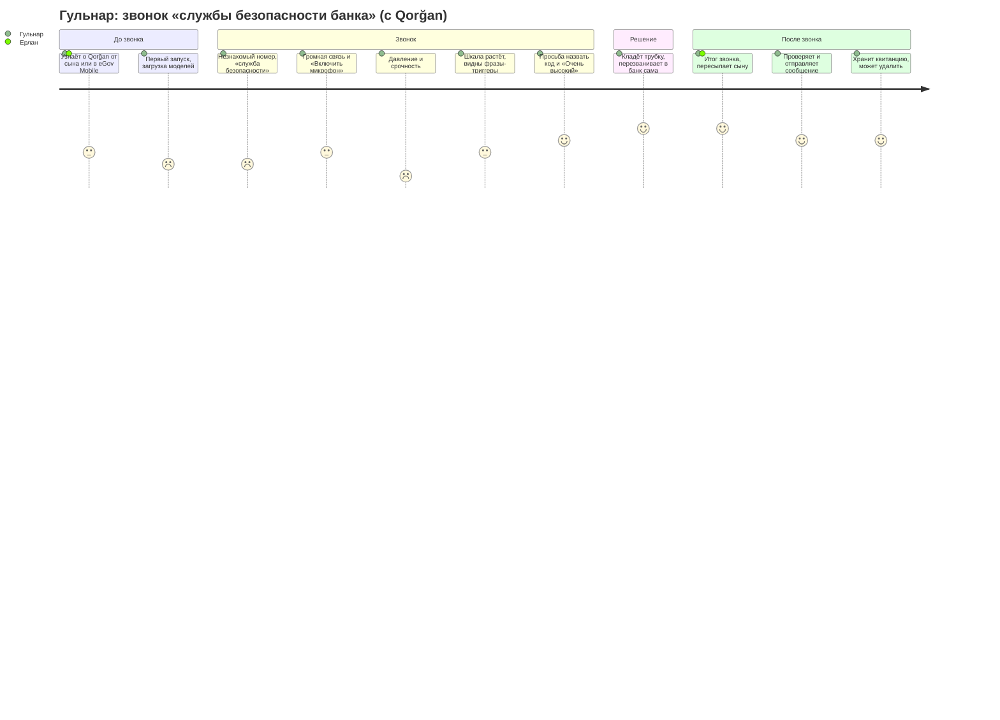
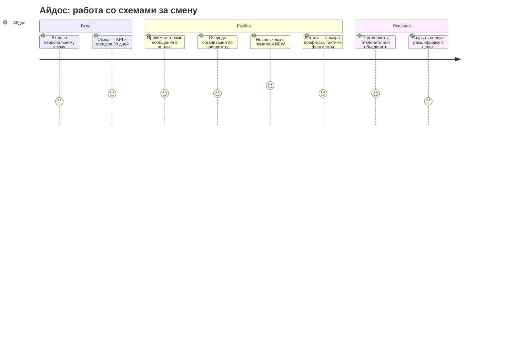

# Qorğan — карта пути пользователя (CJM)

_Версия 2026-11-10. Описывает то, что работает в коде сегодня (ветка `main` + ADR D87). Где шаг
относится к будущей интеграции, он помечен **[предложение]**. Цифры взяты из
`docs/eval_report.md` и ADR в `docs/DECISIONS.md`._

**Qorğan** замечает приёмы социальной инженерии в телефонном разговоре на казахском, русском и
смешанном языке, **пока звонок ещё идёт**. Он показывает шкалу подозрения 0–100, дословные фразы,
которые к ней привели, и что делать. Анализ идёт на устройстве; решение всегда за человеком:
система ничего не блокирует, никуда не сообщает сама и не кладёт трубку.

В документе три пути:
1. **Гражданин** — основной путь (Уровень 1, на устройстве).
2. **Аналитик / следователь** — работа с добровольными сообщениями граждан (Уровень 2).
3. **Партнёр** (банк, оператор связи, горячая линия) — короткий путь через API.

---

## 0. На чём построена карта и чего в ней нет

| Источник | Что он дал карте |
|---|---|
| Сообщение Нацбанка РК (на 01.01.2026: 80 871 инцидент в Антифрод-центре) и статистика КПСиСУ (26,3 тыс. правонарушений за январь–ноябрь 2025) | масштаб проблемы и то, что меры работают **до** разговора (блокировка номера) или **после** (антифрод по транзакции), но не **во время** него |
| 47 реальных фраз мошенников из опубликованных приговоров (`court_quotes`, ADR D68) | как на самом деле звучат этапы давления: «служба безопасности», код из СМС, «безопасный счёт», «никому не говорите» |
| Таксономия: 15 тактик в поставляемой модели, 28 в таксономии v3, 26 схем (`data/taxonomy/`, ADR D63, D73) | этапы сценария мошенника, которые карта накладывает на путь гражданина |
| Правовая оценка (`docs/LEGAL_ASSESSMENT.md`) и вердикт независимого совета (`qorgan-council-verdict.md`) | где нужны согласие, проверка человеком, минимизация данных |
| Измерения продукта (ADR D76, D78, D86) | что гражданин реально видит и сколько ждёт |

**Честная оговорка.** Интервью с пострадавшими и аналитиками по сценарию
`docs/DISCOVERY.md` ещё не проведены, а реальных записей звонков у нас нет
(`docs/DATA_INTAKE.md`). Поэтому эмоции и боли в карте — гипотезы, собранные из открытых
источников и приговоров. Их нужно проверить на пилоте (§5).

---

## 1. Персоны

### 1.1 Гульнар, 61 год, Караганда — главный пользователь
- Пенсионерка, говорит по-казахски и по-русски, часто переходит с одного языка на другой в одной фразе.
- Пользуется Kaspi и eGov Mobile на Android-смартфоне; дома есть ноутбук, который настроил сын.
- Слышала о мошенниках по телевизору, но уверена, что «со мной такого не будет».
- **Чего боится:** потерять пенсию; что карту «заблокируют»; показаться невежливой с «сотрудником банка».
- **Что нужно:** простой и понятный сигнал «это похоже на мошенничество» на её языке, и конкретное действие.

### 1.2 Ерлан, 34 года, Астана — помощник
- Сын Гульнар. Сам мошенникам почти не верит, но переживает за родителей.
- Ставит родителям приложения и объясняет, как ими пользоваться.
- **Что нужно:** приложение, которому можно доверить родителей: без регистрации, без передачи
  разговоров «куда-то», с понятными подсказками. И возможность переслать итог звонка.

### 1.3 Айдос, аналитик антифрод-подразделения — пользователь Уровня 2
- Работает в госоргане или у партнёра (банк, оператор связи) по договору.
- **Что нужно:** видеть **организованные схемы**, а не отдельные жалобы: какие номера связаны,
  какие приёмы повторяются, где появилась новая схема.
- **Ограничения:** закон о ПДн, внутренний контроль доступа, необходимость обосновать каждое
  открытие полной расшифровки.

---

## 2. Путь гражданина: звонок «службы безопасности банка»

Сценарий типичный по приговорам и нашей таксономии: звонящий представляется сотрудником банка,
сообщает о «подозрительной операции», давит срочностью, просит код из СМС и перевод на
«безопасный счёт», требует никому не говорить.

### 2.1 Кривая эмоций

_Оценки 1–5 — гипотеза о самочувствии гражданина на каждом шаге (5 — спокойно и под контролем)._

### 2.2 Карта по этапам

| | **1. Узнать и установить** | **2. Звонок начался** | **3. Давление** | **4. Ключевая просьба** | **5. Решение** | **6. После звонка** | **7. Позже** |
|---|---|---|---|---|---|---|---|
| **Цель** | Получить защиту от мошенников без сложной настройки | Понять, кто звонит | Не растеряться | Не отдать деньги и код | Безопасно закончить разговор | Рассказать близким, помочь найти мошенников | Контролировать свои данные |
| **Действия** | Открывает ссылку или приложение; первый запуск | Включает громкую связь, открывает «Проверить звонок», нажимает «Включить микрофон» | Слушает про «подозрительную операцию» | Слышит «назовите код из СМС», «переведите на безопасный счёт» | Кладёт трубку; звонит в банк по номеру с карты | Читает итог; копирует его; открывает «Посмотреть сообщение» | Вводит номер квитанции, чтобы удалить сообщение |
| **Точки контакта** | Лендинг `index.html`; PWA или Android-приложение (TWA); **[предложение]** мини-сервис в eGov Mobile | `live.html`, запрос доступа к микрофону | Строки разговора с пометкой языка каждого слова, шкала 0–100 | Шкала «Очень высокий», подсвеченная фраза, тактика, блок «Что делать» | Блок «Что делать»: «положите трубку и сами перезвоните по официальному номеру» | «Итоги звонка», «Скопировать итог», форма сообщения | Блок «Удалить по квитанции» на `live.html` |
| **Мысли и эмоции** | «Это сложно? Мои разговоры куда-то уйдут?» | Тревога: «С моей картой что-то не так?» | Страх, спешка, неловкость перед «сотрудником» | «Вдруг правда банк?» | Облегчение, но и сомнение | Желание предупредить других | Спокойствие: «я решаю, что хранится» |
| **Боли без Qorğan** | Защитные меры не видны человеку | Номер может выглядеть «официально» | Никто не слышит разговор, кроме мошенника | Решение под давлением за секунды | Стыд, страх ошибиться | Жалоба — долго и непонятно куда | Нет контроля над тем, что о тебе хранят |
| **Что делает Qorğan** | Лендинг объясняет, что делает и чего не делает система, с пометкой об ИИ и размером загрузки; модели загружаются **один раз**, после первого посещения проверка работает без сети (D86) | Распознаёт речь на устройстве. На компьютере Vosk KK + RU показывает слова сразу, а GigaAM заново расшифровывает каждую фразу (D64, D70); на телефоне и в WebView — облегчённый режим, только GigaAM (D67). Звук не покидает браузер | Скользящее окно → эмбеддинги e5 → калиброванная модель → шкала, видна с первой фразы. Тревога фиксируется не раньше 3-й фразы, если не сработал жёсткий сигнал: так приветствие настоящего банка не вызывает тревогу (D29) | Жёсткий сигнал (код из СМС, «безопасный счёт», удалённый доступ, «никому не говорите», номер карты и CVV) сразу поднимает шкалу: один — не ниже 61 («Высокий»), два — не ниже 81 («Очень высокий»). Фраза показана **дословно**, тактика названа, совет — из проверенного текста, а не от LLM | Ничего не делает сам: не блокирует, не звонит, не сообщает. Совет безопасен даже при ложной тревоге — перезвонить в банк по официальному номеру | Итог: уровень, признаки, «почему», «что делать». Сообщение: текст можно править, предпросмотр скрывает номера, карты, ИИН, e-mail, имена; признаки можно снять; номер звонившего — по желанию; отправка только после галочки согласия | Квитанция из 24 символов. По ней сообщение удаляется из очереди и анализа. Сервер удаляет его и сам через 180 дней |
| **Измерение / доказательство** | Языки интерфейса: kk / ru / en; страницы не обращаются к чужим серверам (тест `tests_js/pages.test.mjs`) | Строка появляется через 1,9–2,2 с после конца фразы (медиана); 4,9–5,8 с на медленных ядрах — имитация телефона (D78) | Медиана — тревога на 3-й фразе (`eval.stream`) | Демо-сцены (`site/core/scenarios.json`): русский мошенник 98/100, казахский 97/100, настоящий звонок банка 26/100 («Низкий»); голосом — 98, 97 и 19 (D86) | Ни один маршрут сервера не принимает аудио и не может «нажать кнопку» за человека (`tests/test_architecture.py`) | Очистка ПДн одинакова в Python, JS и Kotlin на 124 эталонных случаях | Удаление и срок хранения закреплены тестами (инвариант 6) |
| **Риски и что улучшить** | Первая загрузка: около 300 МБ для проверки текста, около 530 МБ для голоса на телефоне, около 630 МБ на компьютере — тяжело для мобильного интернета → загрузка по Wi-Fi; предупреждение о размере уже есть | Сейчас страница просит положить телефон на громкой связи **рядом со вторым устройством** (лучше всего — компьютер с Chrome) или вставить текст после звонка. Работа на том же телефоне, что и звонок, не проверена — это главная гипотеза для пилота (§5) | Ловит 45,5 % мошеннических звонков чужого генератора (каз 38 %, рус 56 %) → упор на советы, а не на «зелёный свет» | 1 ложная тревога на 19 настоящих звонков (5,3 %) → совет «перезвоните сами» не вредит даже при ошибке | — | Длинный текст сложно проверять пожилому человеку → короткий итог и галочки признаков | — |

### 2.3 Тот же путь без мошенничества: звонит настоящий банк

Это самая важная проверка доверия: если система тревожит на каждом звонке банка, её выключат.

| Этап | Что видит гражданин |
|---|---|
| Звонок | Сотрудник называет себя, говорит о договоре, **не просит** код и перевод |
| Шкала | На демо-сцене настоящего звонка первые две фразы — «Средний» (37 и 33: так начинаются и мошеннические звонки), дальше «Низкий» (29, 26). Тревога не фиксируется |
| Если банк сам предупреждает «никому не сообщайте код из СМС» | **Известная слабость.** В модели есть флаг успокоения («мы никогда не спрашиваем код»), но упоминание кода само поднимает шкалу до «Высокого», а иногда и выше (измерено, не исправлено: ADR D56). Так же тревожат разговоры **о** мошенничестве («соседку чуть не обманули»): они говорят тем же словарём (D74–D76, README §10). Совет и в этом случае безопасен: перезвонить в банк по официальному номеру |
| Итог | Ничего не нужно отправлять; Qorğan не хранит разговор |

### 2.4 Каналы, через которые гражданин попадает на этот путь

| Канал | Состояние |
|---|---|
| Веб-страница в Chrome (PWA, устанавливается на главный экран) | **работает**: https://govtech-production.up.railway.app |
| Android-приложение (Trusted Web Activity) | **собирается**: подписанный APK и пакет для Google Play (ADR D87); нужен домен и ключ подписи |
| Мини-сервис внутри eGov Mobile (WebView) | **[предложение]**: тестовая оболочка `android/webview-shell/` собирается, облегчённый голосовой режим для WebView готов (D67); нужно решение НИТ (`docs/egov/QUESTIONS_FOR_NITEC.md`) |
| Подтверждение сообщения через eGov QR-подпись | **[предложение]**: схема в `docs/egov/API_SPEC.md` |

---

## 3. Путь аналитика: от сообщений к организованной схеме

### 3.1 Кривая эмоций

### 3.2 Карта по этапам

| | **1. Вход** | **2. Обзор** | **3. Приём сообщений** | **4. Очередь схем** | **5. Детали** | **6. Решение** | **7. Полная расшифровка** |
|---|---|---|---|---|---|---|---|
| **Цель** | Попасть в консоль с правильной ролью | Понять обстановку | Добавить новые сообщения граждан | Решить, чем заняться сначала | Убедиться, что это одна схема | Зафиксировать вывод | Проверить конкретный случай |
| **Действия** | Вводит ключ на `admin.html` | Смотрит KPI, тренд, топ организаций | Нажимает «принять сообщения в анализ» | Просматривает организации по приоритету | Открывает организацию | Подтверждает, отклоняет или объединяет | Выбирает цель и открывает текст |
| **Что делает Qorğan** | Ключ даёт личность и роль: analyst или investigator; без ключей консоль закрыта (`/api/admin` → 503) | `/api/admin/overview`, `/api/admin/stats`: только агрегаты | `/api/admin/ingest`: сообщение привязывается к организации по графу общих номеров; новое — отдельная «новая схема» | Организации названы по главным тактикам; приоритет = размер (0,4) + свежесть (0,35) + рост (0,25), с поправкой на решения аналитиков (`analytics/rank.py`) | Номера только префиксами (`+7 700 ***`), фрагменты ≤ 200 символов, тактики со счётчиками | Решение хранится событием и переживает перекластеризацию; отклонённая организация опускается до 20 % приоритета (D24) | Только роль investigator, цель (`pattern_review` / `citizen_request` / `partner_request`), не больше 30 открытий в час; запись в журнал аудита **до** выдачи текста |
| **Боли без Qorğan** | Общие учётки, нет следа, кто что смотрел | Отдельные жалобы без связи | Ручной разбор каждой жалобы | Не видно, какая схема растёт | Номера и ПДн в открытом виде | Решения теряются при пересчёте | Неограниченный доступ к разговорам граждан |
| **Риски** | Ключи — временная замена SSO с MFA (пробел M9) | Данные на демо вымышленные | — | Качество кластеров на реальных данных не измерено | — | — | Журнал — HMAC-цепочка, проверка `python -m qorgan.audit verify`; внешний WORM-якорь — **[предложение]** |

**Что аналитик не может сделать — намеренно.** Найти человека по номеру (номера хранятся как
HMAC-дайджест), увидеть аудио (его нет на сервере), открыть разговор без цели и следа в журнале.

**[предложение] Следующий шаг пути:** выпустить сигнал по организации участнику Антифрод-центра
или оператору связи (дайджест номера, после проверки аналитиком). Схема — `docs/egov/API_SPEC.md`.

---

## 4. Путь партнёра (банк, оператор, горячая линия)

| Этап | Действие | Что делает Qorğan |
|---|---|---|
| Подключение | Получает ключ `X-API-Key` и дневную квоту | Ключ на партнёра; без ключей API закрыт |
| Отправка случая | `POST /api/v1/reports`: тактики подтверждённого случая, номер, `consent_basis` | Номер хешируется; текст принимается только уже очищенным; повтор по `partner_reference` не создаёт дубликат; 60 запросов в минуту и квота за 24 часа |
| Получение картины | `GET /api/v1/organizations` | Только агрегаты: без номеров, дайджестов и текстов |
| Отзыв | `DELETE /api/v1/reports/{receipt}` | Партнёр удаляет только свои сообщения |

---

## 5. Выводы и что проверить на пилоте

**Моменты истины.**
1. **Первая ложная тревога на настоящем звонке.** Поэтому главная метрика проекта — доля ложных
   тревог, а совет при тревоге безопасен и при ошибке (перезвонить по официальному номеру).
2. **Просьба назвать код.** Здесь Qorğan должен быть самым громким и самым понятным: жёсткий
   сигнал сразу поднимает шкалу до «Высокого» или «Очень высокого», фраза показана дословно. Обратная
   сторона — честное предупреждение банка о коде тоже поднимает шкалу (D56).
3. **Отправка сообщения.** Доверие держится на том, что человек видит, что именно уйдёт, и может
   это исправить или удалить.

**Гипотезы, которые карта не может подтвердить без пилота.**

| Гипотеза | Как проверить |
|---|---|
| Пожилой человек успевает включить проверку в начале звонка | Наблюдение на пилоте; режим «вставить текст после звонка» как запасной путь |
| Проверка на втором устройстве приемлема (или нужен режим на том же телефоне) | Испытание на реальных Android-телефонах (план C2); решение НИТ о мини-сервисе |
| Совет и итог понятны на казахском без помощи родственников | Проверка текстов носителем языка; юзабилити-тест |
| Сообщения граждан действительно складываются в организации | Реальные данные по протоколу `docs/DATA_INTAKE.md` |

**Связанные документы:** техническая документация — [`docs/TECHNICAL.md`](TECHNICAL.md);
текущее состояние — [`docs/STATUS.md`](STATUS.md); правовая оценка —
[`docs/LEGAL_ASSESSMENT.md`](LEGAL_ASSESSMENT.md); пакет для НИТ — [`docs/egov/`](egov/README.md).
