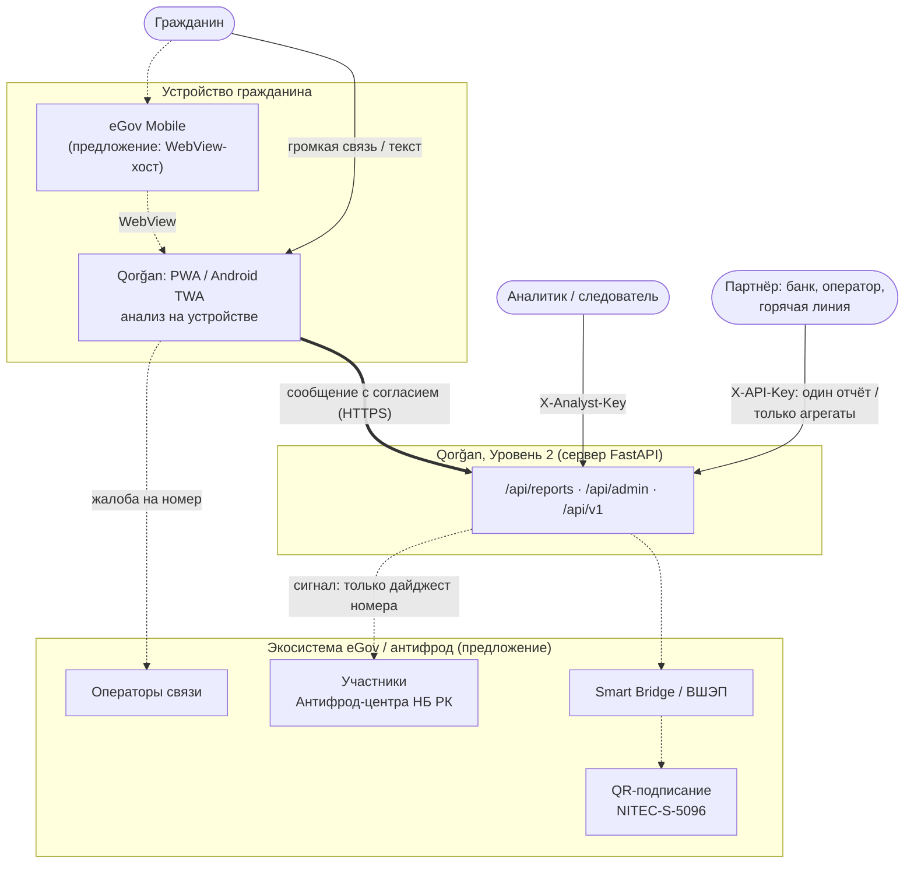
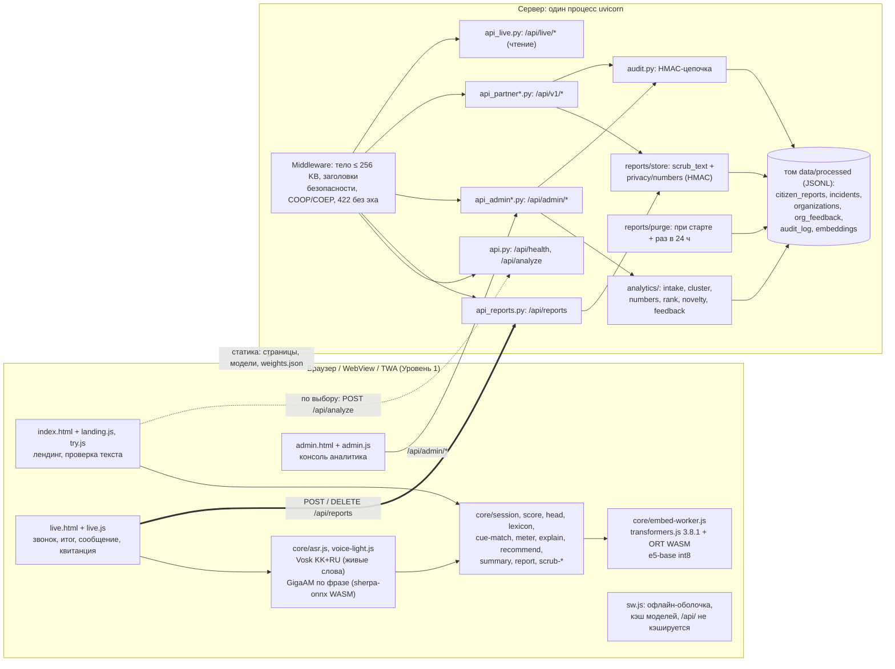
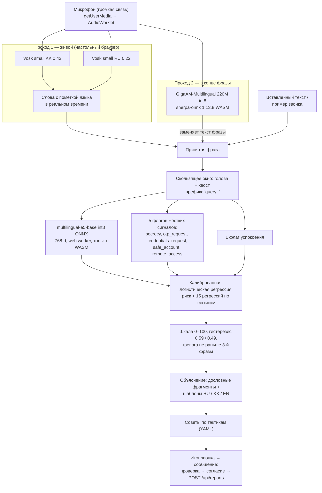
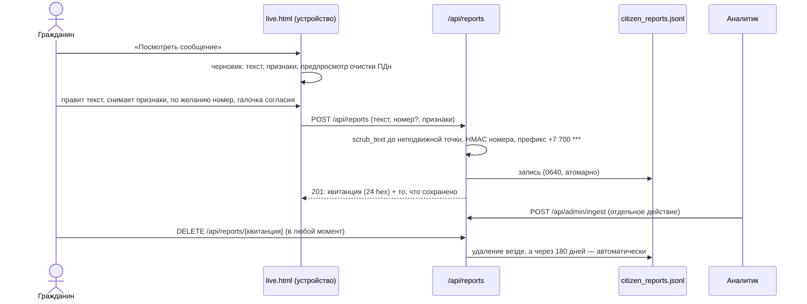

# Qorğan — техническая документация

_Версия 2026-11-10, соответствует коду ветки `main` + ADR D87. Здесь собрано всё в одном месте:
архитектура, стек, модули, интеграции, развёртывание. Подробности по каждому решению — в
`docs/DECISIONS.md` (ADR D1–D87), все числа с интервалами — в `docs/eval_report.md`._

**Обозначения.** **[факт]** — так работает код сегодня. **[предложение]** — проект решения для
пилота, не реализован.

## Содержание
1. [Назначение и границы](#1-назначение-и-границы)
2. [Архитектура](#2-архитектура)
3. [Архитектурные инварианты](#3-архитектурные-инварианты)
4. [Технологический стек](#4-технологический-стек)
5. [Модули](#5-модули)
6. [Модель и данные](#6-модель-и-данные)
7. [API](#7-api)
8. [Интеграции](#8-интеграции)
9. [Приватность и безопасность](#9-приватность-и-безопасность)
10. [Развёртывание](#10-развёртывание)
11. [Конфигурация](#11-конфигурация)
12. [Эксплуатация](#12-эксплуатация)
13. [Тестирование и CI](#13-тестирование-и-ci)
14. [Ограничения и известные риски](#14-ограничения-и-известные-риски)
15. [Карта документов](#15-карта-документов)

---

## 1. Назначение и границы

Qorğan — система **поддержки решений** для распознавания телефонного мошенничества (социальной
инженерии) в разговорах на казахском, русском и смешанном языке.

| Уровень | Пользователь | Где работает | Что делает |
|---|---|---|---|
| **Уровень 1** | гражданин | **на устройстве** (браузер, PWA, Android-приложение) | распознаёт речь, оценивает разговор по ходу звонка, объясняет оценку, даёт советы, готовит сообщение |
| **Уровень 2** | аналитик / следователь | сервер | собирает **только добровольные** сообщения граждан и партнёров в «организации» мошенников по графу общих номеров |

**Чего система не делает — по построению, а не по настройке:** не принимает аудио на сервере, не
блокирует звонки, не сообщает никуда сама, не кладёт трубку, не показывает пользователю текст,
сочинённый языковой моделью. Решение всегда принимает человек.

---

## 2. Архитектура

### 2.1 Контекст



Сплошные линии — **[факт]**, пунктир — **[предложение]** (обоснование и источники:
`docs/egov/README.md`, `docs/research/2026-10/egov_integration.md`).

### 2.2 Контейнеры



Модули пути гражданина (`api.py`, `api_live*.py`, `api_reports*.py`, `api_partner.py`, `live/*`)
**не могут** импортировать запись в аналитику: это проверяет AST-тест в
`tests/test_architecture.py`. Сообщения попадают в анализ только через явный
`POST /api/admin/ingest`.

### 2.3 Конвейер на устройстве



**Режимы голоса.** На настольном Chrome работают оба прохода. На телефонах и в Android
WebView — **облегчённый режим**: только GigaAM и детектор речи по энергии, без живых слов (ADR D67).
WebView не поддерживает изоляцию между источниками (COOP/COEP), без которой Vosk не работает.

### 2.4 Поток сообщения гражданина



---

## 3. Архитектурные инварианты

Закреплены тестами `tests/test_architecture.py` и не нарушаются ни одним изменением.

1. **Ни один маршрут не принимает аудио** — нет WebSocket, нет аудио и multipart-тел (D12).
2. **`/api/analyze` ничего не сохраняет** (снимок `data/` до и после запроса).
3. **У Уровня 2 ровно два входа:** `POST /api/reports` (гражданин) и `POST /api/v1/reports`
   (партнёр с согласием, D19).
4. **Номера телефонов не хранятся в открытом виде:** только HMAC-дайджест и префикс `+7 700 ***`.
5. **Хранимые расшифровки очищены от ПДн.**
6. **У каждого сообщения есть квитанция, его можно удалить, и оно истекает** по часам сервера
   (`QORGAN_REPORT_RETENTION_DAYS`, по умолчанию 180; очистка при старте и раз в сутки).
7. **Каждый маршрут `/api/admin` требует аналитика** (`X-Analyst-Key`) и закрыт при отсутствии
   ключей; полная расшифровка — только роль investigator и указанная цель; журнал аудита — HMAC-цепочка.
   Единственное исключение по выбору — `QORGAN_ADMIN_OPEN_ACCESS` для демо с вымышленными данными (D59).

Каждый пишущий маршрут перечислен в тесте поимённо: новый маршрут без записи там не пройдёт CI.

---

## 4. Технологический стек

| Слой | Технологии | Версии и примечания |
|---|---|---|
| Сервер | Python, FastAPI, Uvicorn, Pydantic | Python 3.11+, один процесс (§10.2) |
| Модель на сервере | ONNX Runtime, tokenizers, scikit-learn, NumPy, pandas | `onnxruntime==1.21.*` — **закреплён** под ту же версию, что в transformers.js, для побитово одинаковых эмбеддингов (D32) |
| Аналитика Уровня 2 | NetworkX (граф общих номеров) | HDBSCAN — только исследовательский путь, выключен |
| Эмбеддер | `Xenova/multilingual-e5-base`, int8 ONNX, 768-d | ~278 МБ; одна модель для kk, ru и смешанной речи |
| Браузер: модель | transformers.js 3.8.1 + onnxruntime-web (WASM) в web worker | WebGPU не используется: ломает int8-граф (D32) |
| Браузер: речь | Vosklet 1.2.1 (Vosk WASM), модели `vosk-model-small-kz-0.42`, `vosk-model-small-ru-0.22`; sherpa-onnx 1.13.8 WASM + GigaAM-Multilingual 220M CTC int8 | всё размещено на нашем сервере и проверено по хешу; ни одного обращения к CDN во время работы (D61) |
| Фронтенд | Vanilla JS (ES-модули), HTML, CSS, service worker | без фреймворка и сборщика; шрифты Inter и IBM Plex Mono размещены у нас (D83) |
| Локализация | `site/i18n.js`, `site/i18n-admin.js`; YAML для советов и объяснений | kk / ru / en |
| Хранилище | JSONL-файлы на томе, атомарная запись | пилот: Postgres **[предложение]** |
| Android | Trusted Web Activity (Bubblewrap 1.24 + androidbrowserhelper 2.7.4); WebView-оболочка (Java); ядро на Kotlin (AAR, onnxruntime-android 1.21.0, DJL tokenizers 0.33.0) | minSdk 24 (TWA) / 26 (WebView), targetSdk 35–36 |
| Контейнер | Docker (многоэтапная сборка), Docker Compose | непривилегированный пользователь uid 10001, корневая ФС только для чтения |
| Хостинг демо | Railway | вне РК, только вымышленные данные |
| Модели и корпус | Hugging Face Hub (`sanzh-ts/govtech`, `sanzh-ts/govtech_ds`) | загружаются только при сборке |
| Генерация данных | Gemini и Claude (обучающие диалоги), локальная Qwen3.5-9B-Kazakh (независимые тестовые наборы) | только на этапе подготовки данных, не в продукте |
| Тесты | pytest, Node test runner, Playwright 1.56.1, JUnit 4 (Kotlin) | §13 |
| CI | GitHub Actions | ruff + pytest, npm test |

---

## 5. Модули

### 5.1 Сервер: `src/qorgan/`

| Модуль | Назначение |
|---|---|
| `api.py` | приложение FastAPI: middleware, раздача `site/`, `/api/health`, `/api/analyze` |
| `api_reports.py` | сообщения граждан: создание и удаление по квитанции |
| `api_admin.py`, `api_admin_stats.py`, `api_admin_auth.py` | консоль аналитика: сессия, обзор, статистика, организации, решения, разбор случая, открытие расшифровки, приём сообщений; ключи, роли, лимиты |
| `api_partner.py`, `api_partner_export.py`, `partners.py` | партнёрский API: ключи, квоты, отчёт, удаление, экспорт агрегатов |
| `api_live.py` | только чтение: возможности сервера и демо-сценарии |
| `api_limits.py`, `api_ratelimit.py` | лимит тела запроса, скользящие окна по частоте |
| `audit.py` | журнал аудита как HMAC-цепочка; `python -m qorgan.audit verify` |
| `analysts.py` | реестр ключей аналитиков и ролей |
| `config.py` | **все константы и настройки** (переменные окружения, пороги, пути) |
| `jsonl.py`, `atomic.py` | чтение JSONL (устойчиво к U+2028, D85) и атомарная запись |
| `cloud_tier.py`, `llm_tools.py` | облачный уровень Gemini: выключен по умолчанию, требует согласия на каждый запрос (D49) |
| `classifier/` | эмбеддинги, признаки, сопоставление сигналов, калибровка, обучение линейной модели, экспорт весов для браузера |
| `explain/` | объяснения и советы: шаблоны и YAML на ru/kk/en, роли звонящего, схемы |
| `live/` | шкала, сессия звонка и итог (эталон для JS-порта) |
| `data/` | сборка корпуса, генерация, очистка ПДн (`scrub*.py`), защита публикации |
| `privacy/numbers.py` | HMAC номеров и префиксы |
| `reports/` | хранилище сообщений, очистка по сроку, представления для партнёров |
| `analytics/` | приём сообщений, граф номеров, кластеры, приоритет, новые схемы, решения аналитиков, статистика |
| `asr/` | упаковка моделей Vosk и GigaAM для браузера, инструменты захвата для оценки |
| `eval/` | оценка: разбиения, потоковый режим, интервалы Клоппера — Пирсона, кластеры, состязательные проверки |
| `web/` | конфигурация клиента (`qorgan-config.json`), закреплённая среда выполнения эмбеддера |

### 5.2 Устройство: `site/`

| Файл / модуль | Назначение |
|---|---|
| `index.html`, `landing.js`, `try.js` | лендинг; проверка вставленного текста на устройстве или, по выбору, на сервере |
| `live.html`, `live.js` | проверка звонка: пример, микрофон, шкала, итог, сообщение, удаление по квитанции |
| `admin.html`, `admin.js` | консоль аналитика |
| `sw.js`, `manifest.webmanifest` | PWA: офлайн-оболочка, кэш моделей, который переживает обновление (D86) |
| `core/session.js`, `meter.js`, `score.js`, `head.js` | окно, шкала с гистерезисом, оценка, головы модели — порт Python 1:1 |
| `core/lexicon.js`, `cue-match.js` | жёсткие сигналы, сопоставление с допуском на ошибки распознавания (D39) |
| `core/explain.js`, `recommend.js`, `role.js`, `highlight.js`, `attribution.js` | объяснения, советы, роль звонящего, подсветка фраз |
| `core/summary.js`, `report.js`, `scrub-*.js` | итог звонка, черновик сообщения, очистка ПДн |
| `core/embedder.js`, `embed-worker.js`, `embed-cache.js` | эмбеддинги в web worker; кэш фраз внутри звонка (D78) |
| `core/asr.js`, `voice-light.js`, `gigaam*.js`, `endpoint*.js`, `vad.js`, `word-*.js`, `span-vote.js` | распознавание речи: живой проход, облегчённый режим, второй проход, язык каждого слова |
| `core/qorgan-config.json`, `models/weights.json` | пороги, сигналы, тексты, советы; **поставляемые веса модели** |

### 5.3 Android: `android/`

| Каталог | Что это | Состояние |
|---|---|---|
| `twa/` | Android-приложение (Trusted Web Activity) поверх PWA | собирается: подписанный APK и AAB (D87); нужны домен и ключ |
| `webview-shell/` | оболочка, повторяющая мини-сервис eGov Mobile (WebView, только микрофон, один источник) | собирается: debug и release |
| `qorgan-core/` | нативное текстовое ядро на Kotlin (AAR) для встраивания без WebView | совпадает с Python на эталонах; **не выпускается** как оценщик для граждан (§14) |

### 5.4 Прочее

| Каталог | Назначение |
|---|---|
| `scripts/` | `deploy_bootstrap.py` (модели и данные), `preflight.py` (проверка развёртывания), `hf_upload.py`, `export_parity_fixtures.py`, `pooled_judges.py` (главная метрика) и др. |
| `data/` | таксономия, словари сигналов, происхождение данных (`data/README.md`) |
| `tests/`, `tests_js/` | Python- и JS-тесты; `tests_js/tools/` — браузерные проверки (Playwright) |
| `app/` | Streamlit — **только локальный стенд разработчика** (D4), не продукт |
| `docs/` | вся документация (§15) |

---

## 6. Модель и данные

**Признаки.** Голова + хвост скользящего окна с префиксом `query: ` → эмбеддинг e5-base (768) ⊕
5 флагов жёстких сигналов ⊕ 1 флаг успокоения.

**Модель.** Калиброванная логистическая регрессия для риска и 15 регрессий по тактикам. Тревога —
при риске ≥ 0.59, гистерезис 0.59 / 0.49. Шкала видна с первой фразы, а тревога фиксируется не раньше
3-й, если не сработал жёсткий сигнал (D29). Жёсткий сигнал поднимает шкалу не ниже 61 («Высокий»),
два — не ниже 81 («Очень высокий»).

**Обучение на эмбеддингах браузера.** Головы обучаются на эмбеддингах, которые выдаёт сам
браузер (`QORGAN_EMBED_BACKEND=device`, мост `npm run device:serve`), поэтому метрики описывают то,
что видит гражданин (D33). Сервер считает теми же весами (`site/models/weights.json`) на нативном
ONNX Runtime — это задокументированное приближение (косинус около 0.98).

**Паритет.** `site/core/*.js` — порт Python-классификатора, шкалы, объяснений, сопоставления
сигналов и очистки ПДн 1:1, закреплённый эталонными фикстурами (`npm test`). Kotlin-ядро проверяется
по тем же фикстурам.

**Данные.** Поставляемая модель обучена на `train` (1 880 диалогов) и `val` (135); оценивается на
`test` (143), `ood` (118), `authored_heldout` (42), `shift` (66) и 828 независимых звонках `shift_local*`.
Для переобучений v2–v3.1 сгенерировано ещё более 3 000 диалогов (в поставляемую модель не вошли).
Таксономия: 15 тактик в поставляемой модели, 23 в v2, 28 в v3; 26 схем (`data/taxonomy/`).
Происхождение каждого набора — `data/README.md`, `docs/DATA_SOURCES.md`.

**Качество — главная цифра** (v1 на шести независимых наборах `shift_local*`, 828 звонков kk + ru,
написанных локальной моделью другого семейства; `scripts/pooled_judges.py`, D76):

| | Ложные тревоги [95% ДИ] | Пойманные мошенники [95% ДИ] |
|---|---|---|
| Все | 22/417 = 0.053 [0.033, 0.079] | 187/411 = 0.455 [0.406, 0.505] |
| Казахский | 16/249 = 0.064 | 95/248 = 0.383 |
| Русский | 6/168 = 0.036 | 92/163 = 0.564 |

Главная метрика — **доля ложных тревог (FPR)**. Ни одно изменение не выпускается, если оно сдвигает
FPR без ADR. Шесть переобучений ловили больше мошенников, но не выпущены: каждое либо тревожило на
семейных просьбах о деньгах и бытовых разговорах, либо не прошло другой заранее записанный порог
(v2.1 — браузерный шлюз), D63–D76.

**Поставка модели.** Закоммиченный `site/models/weights.json` — это и есть поставляемая модель.
Любая правка словаря сигналов требует переобучения и обучающих данных (бандл проверяет хеш словарей).

---

## 7. API

Полная интерактивная схема — `/docs` (OpenAPI) на работающем сервере.

| Метод и путь | Кто | Что делает | Лимит |
|---|---|---|---|
| `GET /api/health` | все | статус, бэкенд, порог, источник весов | — |
| `POST /api/analyze` | все | оценка текста на сервере по выбору гражданина; **ничего не сохраняет** | 30 / мин |
| `GET /api/live/capabilities`, `GET /api/live/scenarios` | все | что умеет сервер; демо-сценарии | — |
| `POST /api/reports` | гражданин | сообщение с согласием → квитанция | 20 / мин |
| `DELETE /api/reports/{receipt}` | гражданин | удалить сообщение везде (по квитанции из 24 hex-символов) | — |
| `GET /api/admin/session` | аналитик | личность, роль, доступные цели | 120 / мин на аналитика |
| `GET /api/admin/overview` | аналитик | KPI и очередь организаций | то же |
| `GET /api/admin/stats` | аналитик | активность за 30 дней, тренд, топ организаций | то же |
| `GET /api/admin/organizations/{id}` | аналитик | номера-префиксы, тактики, фрагменты ≤ 200 символов | то же |
| `POST /api/admin/organizations/{id}/feedback` | аналитик | подтвердить / отклонить / объединить (аудит до записи) | то же |
| `GET /api/admin/incidents/{id}/analysis` | аналитик | разбор фрагмента: риск, тактики, причина | то же |
| `POST /api/admin/incidents/{id}/open` | **investigator** | полная очищенная расшифровка с целью; аудит до выдачи | 30 / час |
| `POST /api/admin/ingest` | аналитик | принять новые сообщения в анализ | то же |
| `POST /api/v1/reports` | партнёр | один подтверждённый случай (тактики или очищенный текст), `consent_basis` | 60 / мин + дневная квота |
| `DELETE /api/v1/reports/{receipt}` | партнёр | удалить только свой отчёт | то же |
| `GET /api/v1/organizations` | партнёр | только агрегаты: без номеров, дайджестов и текстов | то же |

Неверный ключ аналитика: не больше 10 попыток в минуту с одного адреса. Ошибки проверки (422)
никогда не повторяют присланный текст. Тело запроса — не больше 256 КБ.

---

## 8. Интеграции

### 8.1 Работают сейчас **[факт]**

| Система | Как | Когда |
|---|---|---|
| Hugging Face Hub | корпус, эмбеддер, рантайм GigaAM (зеркало, закреплено по коммиту, D77) | только при сборке образа; работающий контейнер ничего не скачивает (`HF_HUB_OFFLINE=1`) |
| alphacephei.com | модели Vosk, проверка по хешу | только при сборке |
| GitHub + Railway | сборка `Dockerfile` из репозитория, HTTPS, переменные окружения | при деплое |
| GitHub Actions | офлайн-тесты Python и JS на каждый push в `main` и pull request | CI |
| Партнёрский API `/api/v1` | приём подтверждённых случаев и выдача агрегатов | по запросу партнёра |
| Gemini (облачный уровень) | второе мнение по тексту | **выключен** (`QORGAN_CLOUD_TIER=off`); если включить — нужно согласие на каждый запрос; не используется в маршрутах аналитика (D49) |

### 8.2 Предлагаемые для пилота **[предложение]**

| Интеграция | Что даёт | Что нужно | Документ |
|---|---|---|---|
| eGov Mobile, мини-сервис в WebView | путь к гражданам через госприложение | решение НИТ, пилотный приказ, разрешение микрофона в хост-приложении | `docs/egov/QUESTIONS_FOR_NITEC.md` |
| Smart Bridge: QR-подписание NITEC-S-5096 | подтверждение личности автора сообщения без хранения ИИН | подключение потребителя, mTLS | `docs/egov/API_SPEC.md` |
| Операторы связи | жалоба на номер (проверка за 2 рабочих дня) | формат жалобы, канал | `docs/egov/README.md` |
| Участники Антифрод-центра НБ РК | сигнал по организации: только дайджест, после проверки аналитиком | соглашение, канал | `docs/egov/API_SPEC.md` |
| Нативное ядро в eGov Mobile (AAR) | работа без WebView | переобучение на нативных эмбеддингах, распознавание речи на Kotlin | `android/CORE_SPIKE.md` |

---

## 9. Приватность и безопасность

| Мера | Где в коде |
|---|---|
| Аудио не покидает устройство: распознавание в браузере, сервер не принимает аудио | `site/core/asr.js`, `tests/test_architecture.py` |
| Сообщение уходит только после проверки и согласия гражданина; текст можно править | `site/live.js`, `site/core/report.js` |
| Очистка ПДн: номера (в том числе продиктованные словами и с паузами), карты, ИИН, IBAN, e-mail, имена; одинаково в Python, JS и Kotlin на 124 эталонах | `data/scrub*.py`, `site/core/scrub-*.js`, `android/qorgan-core/core/src/main/kotlin/kz/qorgan/core/scrub/` |
| Номер — HMAC с секретным ключом + префикс; поиска по номеру нет | `privacy/numbers.py` |
| Квитанция, удаление, срок хранения 180 дней по часам сервера | `reports/`, `reports/purge.py` |
| Ключи аналитиков, роли, цель открытия, 30 открытий в час, аудит до выдачи | `api_admin_auth.py`, `api_admin.py` |
| Журнал аудита — HMAC-цепочка, хранится не меньше трёх лет | `audit.py` |
| Партнёры: ключ, квота, один отчёт за запрос, текст только очищенный, экспорт только агрегатов | `api_partner*.py` |
| Заголовки безопасности, COOP/COEP, лимит тела, 422 без эха | `api.py`, `api_limits.py` |
| Ни одна страница не обращается к другим источникам; рантаймы проверяются по хешу | `tests_js/pages.test.mjs`, D61, D83 |
| Секреты только в `.env` / хранилище секретов; без них сервер закрывает связанные функции | `config.py`, `.env.example` |
| SBOM, аудит зависимостей, bandit, semgrep (74 правила, 0 находок) | `docs/egov/security/`, D83 |

Модель угроз — `docs/egov/ARCHITECTURE.md` §5; чек-лист испытаний — `docs/egov/SECURITY_CHECKLIST.md`;
правовая оценка (ЗРК о ПДн, Закон об ИИ № 230-VIII) — `docs/LEGAL_ASSESSMENT.md`.

---

## 10. Развёртывание

### 10.1 Локально (разработка)

```bash
python3.11 -m venv .venv && source .venv/bin/activate
pip install -e ".[dev]" && cp .env.example .env    # задать секреты в .env (§11)
python scripts/deploy_bootstrap.py                  # корпус, эмбеддер, Vosk, GigaAM, демо-данные Уровня 2 (~690 МБ, один раз)
python -m qorgan.api                                # http://localhost:8000: index · live.html · admin.html · /docs
```

### 10.2 Docker Compose (промышленный режим)

```bash
cp .env.example .env            # QORGAN_NUMBER_HMAC_KEY, QORGAN_AUDIT_CHAIN_KEY, QORGAN_ANALYST_KEYS
docker compose up -d --build
curl -s localhost:8000/api/health   # {"status":"ok","configured_backend":"linear","threshold":0.59,"linear_model_source":"web"}
```

- Образ не содержит ни секретов, ни персональных данных; сборке секреты не нужны.
- Порт открыт только на `127.0.0.1`; корневая ФС только для чтения; пользователь uid 10001.
- Всё состояние — на томе `qorgan-data` (`/app/data/processed`).
- **Один процесс и одна реплика:** лимиты частоты, бюджет открытий и расписание очистки хранятся в
  памяти процесса. Не масштабировать на один том.
- Резервное копирование, обновление и откат — `docs/DEPLOY.md` §5–§6.

### 10.3 Railway (демо)

Railway собирает тот же `Dockerfile` из GitHub. Переменные: три секрета (§11),
`QORGAN_ADMIN_OPEN_ACCESS=investigator` — чтобы жюри открывало консоль без ключа (только вымышленные
данные). Проверка здоровья — `/api/health`. Особенности сборщика и тома — `docs/DEPLOY.md` §8.
Перед показом: `python scripts/preflight.py --base <url>` (только чтение) и `docs/DEMO_RUNBOOK.md`.

### 10.4 Android

| Вариант | Сборка | Что нужно от владельца |
|---|---|---|
| TWA (приложение в Google Play) | `cd android/twa && bubblewrap update --manifest=twa-manifest.json && ./gradlew bundleRelease`, подпись `apksigner` | домен в `twa-manifest.json`; ключ подписи; его SHA-256 в `site/.well-known/assetlinks.json` |
| WebView-оболочка (как в eGov Mobile) | `cd android/webview-shell && ./gradlew assembleRelease -PqorganUrl=https://<host>/live.html` | адрес сервера |
| Kotlin-ядро (AAR) | `cd android/qorgan-core && ./gradlew :aar:assembleRelease` | решение НИТ о нативном пути |

Пошагово — `android/README.md`. Нужны JDK 17 и Android SDK 35.

### 10.5 Контур пилота в РК **[предложение]**

ЦОД на территории РК (размещение ПДн в РК обязательно, п. 2 ст. 12 Закона о ПДн): обратный прокси
с TLS и WAF, Postgres вместо JSONL, хранилище секретов (KMS), WORM-якоря журнала аудита, клиент ШЭП с
mTLS, SSO с MFA для аналитиков, демо-доступ и демо-данные выключены. Диаграмма —
`docs/egov/ARCHITECTURE.md` §3.2; что изменить в коде — `docs/DEPLOY.md` §7.

---

## 11. Конфигурация

Все параметры — в `src/qorgan/config.py`; переменные окружения описаны в `.env.example`.

| Переменная | Назначение | По умолчанию |
|---|---|---|
| `QORGAN_NUMBER_HMAC_KEY` | ключ HMAC для номеров; без него сообщения с номером отклоняются | — (обязателен) |
| `QORGAN_AUDIT_CHAIN_KEY` | ключ цепочки аудита; без него `/api/admin` и `/api/v1` закрыты | — (обязателен) |
| `QORGAN_ANALYST_KEYS` | `id:secret:role,...` (analyst / investigator) | — (консоль закрыта) |
| `QORGAN_PARTNER_API_KEYS` | `partner:secret[:quota],...` | — (API закрыт) |
| `QORGAN_ADMIN_OPEN_ACCESS` | `off` / `analyst` / `investigator` — вход без ключа как `public-demo` | `off` |
| `QORGAN_REPORT_RETENTION_DAYS` | срок хранения сообщений | 180 |
| `QORGAN_REPORT_PURGE_INTERVAL_HOURS` | период очистки | 24 |
| `QORGAN_CLASSIFIER_BACKEND` | `linear` (поставляемый) / `mock` / `llm` | `linear` |
| `QORGAN_LINEAR_WEIGHTS` | `auto` / `web` / `bundle` — какими весами считает сервер | `auto`, в деплое `web` |
| `QORGAN_RISK_THRESHOLD_ENTER` / `_EXIT` | гистерезис шкалы | 0.59 / 0.49 |
| `QORGAN_METER_MIN_TURNS_TO_ARM` | с какой фразы включается шкала | 3 |
| `QORGAN_CLOUD_TIER` | облачный уровень Gemini | `off` |
| `QORGAN_PARTNER_DAILY_QUOTA` | квота партнёра за 24 часа по умолчанию | 200 |

---

## 12. Эксплуатация

| Задача | Команда / место |
|---|---|
| Здоровье | `GET /api/health` (`linear_model_source` показывает, какие веса в работе) |
| Проверка развёртывания перед показом | `python scripts/preflight.py --base <url>` (только чтение) |
| Проверка журнала аудита | `python -m qorgan.audit verify` — называет первую изменённую, удалённую или переставленную запись |
| Очистка по сроку вручную | `python -m qorgan.reports.purge` |
| Публикация модели и данных | `python scripts/hf_upload.py` (модель и словари вместе; отказывается публиковать неочищенные данные, D45) |
| Резервная копия, обновление, откат | `docs/DEPLOY.md` §5–§6 |
| Сценарий показа | `docs/DEMO_RUNBOOK.md` |

---

## 13. Тестирование и CI

| Набор | Что проверяет | Результат (10.11.2026) |
|---|---|---|
| `pytest -q` | API, инварианты архитектуры, приватность, аудит, хранилища, модель, оценка, Docker, Android-упаковка | 1883 пройдено, 2 пропущено, 2 xfail |
| `npm test` | JS-ядро против Python на эталонных фикстурах, страницы, офлайн, шлюз браузерных эмбеддингов | 206 / 206 |
| `./gradlew :core:test -PruntimeGate=true` (`android/qorgan-core`) | Kotlin-ядро против тех же фикстур; 200 звонков против Python | 16 / 16; 0/200 расхождений с Python |
| `tests_js/tools/e2e_*.mjs` (Playwright) | настоящий Chrome: сообщение, i18n, офлайн, голос с настоящими GigaAM и Vosk, консоль | запускаются локально (нужны модели) |
| CI (`.github/workflows/ci.yml`) | ruff + pytest, npm test — на чистой копии без корпуса, моделей и секретов | на каждый push в `main` и PR |

Правило проекта: детерминированный код пишется через тесты; каждое изменение заканчивается
доказательством (число, тест, скриншот).

---

## 14. Ограничения и известные риски

1. **Реальных записей звонков нет.** Все наборы синтетические или написаны вручную; протокол приёма
   готов (`docs/DATA_INTAKE.md`).
2. **Модель ловит меньше половины мошеннических звонков чужого генератора** (0.455; казахский 0.383).
3. **Разговоры о мошенничестве похожи на мошенничество**, и предупреждение самого банка «никому не
   сообщайте код из СМС» может поднять шкалу до «Высокого» (D56) — нужен отдельный признак (D74–D76).
4. **Ни одного запуска на настоящем телефоне.** На компьютере, ограниченном медленными ядрами,
   облегчённый режим использует около 2,1 ГБ памяти, строка появляется через 4,9–5,8 с (медиана),
   максимум 8,1 с (D78).
5. **Нативное Kotlin-ядро** даёт другое решение, чем браузер, на 4 из 200 звонков (другой рантайм
   эмбеддингов) и не умеет распознавать речь — для граждан выпускается только браузерный путь.
6. **Один процесс и JSONL** — достаточно для демо, для пилота нужен Postgres (§10.5).
7. **Правовые пробелы до пилота** (M1–M11 в `docs/LEGAL_ASSESSMENT.md` §6): основание для данных
   звонящего, хостинг в РК, уведомления, договор с партнёром.

---

## 15. Карта документов

| Документ | О чём |
|---|---|
| [`README.md`](../README.md) | обзор и быстрый старт |
| [`docs/CJM.md`](CJM.md) | карта пути пользователя |
| [`docs/STATUS.md`](STATUS.md) | текущее состояние, журнал по датам |
| [`docs/DECISIONS.md`](DECISIONS.md) | архитектурные решения D1–D87 с измерениями |
| [`docs/eval_report.md`](eval_report.md) | все числа качества с интервалами |
| [`docs/DEPLOY.md`](DEPLOY.md) | развёртывание и эксплуатация (Docker, Railway) |
| [`docs/DEMO_RUNBOOK.md`](DEMO_RUNBOOK.md) | подготовка и проведение показа |
| [`android/README.md`](../android/README.md), [`android/CORE_SPIKE.md`](../android/CORE_SPIKE.md) | Android: сборка, ядро, паритет |
| [`docs/egov/`](egov/README.md) | пакет для НИТ: ТЗ, API, потоки ПДн, безопасность, вопросы |
| [`docs/LEGAL_ASSESSMENT.md`](LEGAL_ASSESSMENT.md) | правовая оценка по законодательству РК |
| [`docs/DATA_INTAKE.md`](DATA_INTAKE.md), [`data/README.md`](../data/README.md) | приём реальных данных; происхождение данных |
