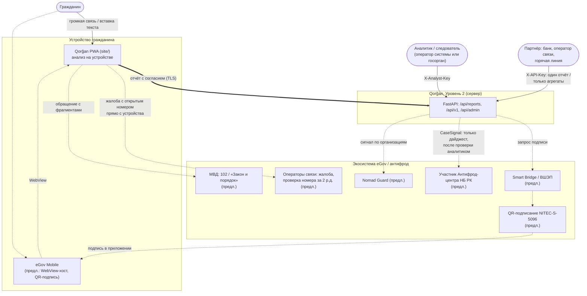
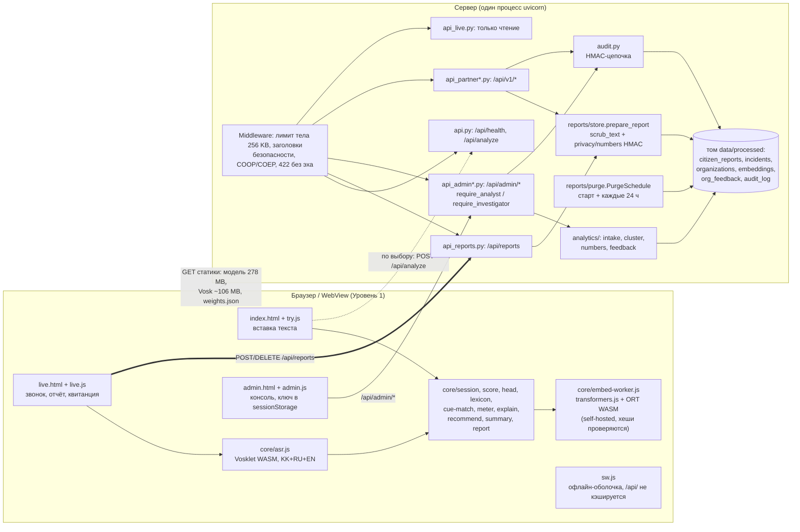
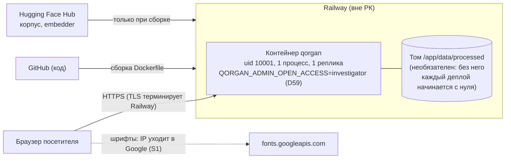
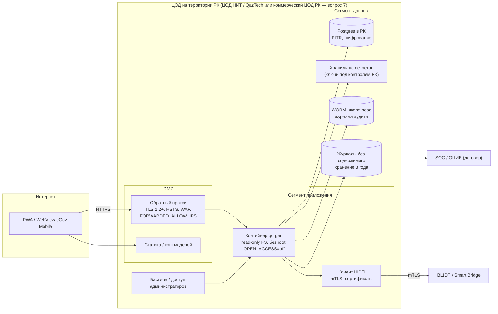
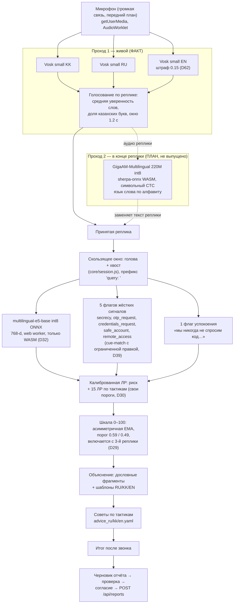

# Архитектура Qorğan — для пилота в экосистеме eGov

> **English summary.** This file has Mermaid diagrams of Qorğan at three levels, plus the
> scoring pipeline: (1) the **context** (citizen, device, Qorğan Level 2, analysts, partners,
> and the planned eGov / Smart Bridge / operator / Antifraud Center links); (2) the
> **containers** (the PWA's on-device modules and the FastAPI server with its file stores, purge
> thread and audit chain); (3) **deployment**, as it is today (a Railway demo outside Kazakhstan)
> and as we propose it for the pilot (a Kazakhstan data centre with TLS/mTLS, a database,
> secret store, WORM audit anchors and a gateway to ШЭП); and (4) the **on-device pipeline**:
> microphone → Vosk live pass, plus a GigaAM-Multilingual pass at each utterance endpoint
> (being built, not shipped) → e5-base int8 embeddings plus cue flags → calibrated logistic
> regression → meter, explanations and advice. Each element is marked as fact (in code today),
> plan (in progress) or proposal.

_Сверено с кодом ветки `sanzh-ts` @ `54a6f0b`. Подробнее о системе — `docs/ARCHITECTURE.md`; часть
этого файла относится к июльской версии, поэтому где файлы расходятся, верен код._

**Обозначения на диаграммах.**
- Сплошная линия — [ФАКТ], существует сейчас.
- Пунктир — [ПРЕДЛОЖЕНИЕ] или [ПЛАН].
- Пометка `(план)` или `(предл.)` стоит в подписи.

## 1. Контекст

Источники для связей с экосистемой: `docs/research/2026-10/egov_integration.md` §1, §2, §5
(NITEC-S-5096 [A]: https://sb.egov.kz/services/passport/NITEC-S-5096 ; проверка номера за 2 р.д. [B]:
https://informburo.kz/novosti/nomera-s-kotoryx-zvoniat-mosenniki-budut-blokirovat-v-kazaxstane-prikaz-vstupil-v-silu ;
у Антифрод-центра нет внешнего входа [A/B]:
https://orda.kz/operatory-svjazi-i-antifrod-centr-budut-formirovat-bazu-potencialnyh-zhertv-moshennikov-411834/ ).

## 2. Контейнеры

[ФАКТ] Модули на пути гражданина (`api.py`, `api_live*.py`, `api_reports*.py`, `api_partner.py`,
`live/*`) **не могут** импортировать запись в аналитику. Это проверяет AST-тест
`test_citizen_path_modules_cannot_reach_analytics_write_paths`. Данные в анализ попадают только
через явный `POST /api/admin/ingest`.

## 3. Развёртывание

### 3.1 Сейчас — демо на Railway ([ФАКТ], `docs/DEPLOY.md` §8)

**Ограничения демо.**
- Данные только вымышленные.
- Хостинг вне РК ([ПРОБЕЛ] M5).
- Открытый вход в консоль (ADR D59).
- Секреты хранятся в переменных платформы.
- Для реальных отчётов это **недопустимо** (`docs/DEPLOY.md` §7–§8).

### 3.2 Предлагаемый контур пилота в РК ([ПРЕДЛОЖЕНИЕ])

**Что меняется по сравнению с текущим кодом** (`docs/DEPLOY.md` §7):
- JSONL заменяется на Postgres. Это снимает ограничение «один процесс», если лимиты и бюджет
  открытий переедут в общее хранилище.
- Секреты переезжают из `.env` в KMS.
- Якоря `head` журнала аудита фиксируются ежедневно в WORM.
- Аналитики входят через SSO с MFA ([ПРОБЕЛ] M9).
- Демо-наполнение (ADR D60) и `QORGAN_ADMIN_OPEN_ACCESS` выключаются.
- Облачный уровень остаётся `off`.
- Шрифты размещаются у нас (S1).

mTLS в промышленной среде Smart Bridge обязателен с 27.02.2026 [A] (https://t.me/s/sb_shep ).
Размещение ПДн в РК обязательно по п. 2 ст. 12 Закона о ПДн [S] (`docs/LEGAL_ASSESSMENT.md` §2.4).

## 4. Конвейер на устройстве

**Пояснения к конвейеру.**

[ФАКТ] Проход 1 реализован в `site/core/asr.js`:
- распознаватели KK и RU работают параллельно, у каждого свой экземпляр Vosklet;
- побеждает гипотеза с большей средней уверенностью слов;
- английский распознаватель участвует со штрафом 0.15 (ADR D62).

На телефонах режим микрофона выключен, пока не пройдена проверка производительности на Android
(`docs/STATUS.md`, B9).

[ПЛАН] Проход 2 описан в `docs/research/2026-10/stt_wordlevel.md`:
- в конце реплики распознаёт её заново моделью GigaAM-Multilingual 220M int8 (MIT, 224.8 MB);
- метрики модели из её карточки: FLEURS WER kk 5.2 / ru 4.4 / en 12.2 [V,
  https://huggingface.co/ai-sage/GigaAM-Multilingual];
- язык каждого слова определяется по алфавиту;
- шкала и сопоставление сигналов работают только по тексту второго прохода.

Бюджет — около 282–365 MB, в зависимости от того, какие модели Vosk останутся. Код пока только в
`scripts/spikes/asr_wordlevel/`; в `site/` его нет.

[ФАКТ] Признаки и классификатор:
- признаки: 768 + 5 + 1;
- риск — калиброванная логистическая регрессия; 15 тактик — отдельные логистические регрессии;
- веса в `site/models/weights.json` — это и есть поставляемая модель;
- сервер считает теми же весами (ADR D55);
- Python и JS дают одинаковый результат на эталонных примерах (`tests_js/`, `scripts/export_parity_fixtures.py`).

[ФАКТ] Объяснения — только дословные фрагменты и шаблоны. **Текст LLM пользователю не
показывается** (`CLAUDE.md`).

## 5. Краткая модель угроз ([ПРЕДЛОЖЕНИЕ] — основа для ТД ИБ)

| Угроза | Где | Мера сейчас ([ФАКТ]) | Что добавить |
|---|---|---|---|
| Перехват или накопление разговоров на сервере | Уровень 1 → сервер | Аудио не принимается; `/api/analyze` ничего не хранит; серверный live-session API выведен (D49) | Подписанный публичный пакет модели и кода для устройства (`LEGAL_ASSESSMENT` §5.3) |
| Удалённое расширение сбора данных («переключатель слежки») | конфигурация | Нет порога автоотправки, управляемого сервером; отчёт — только по действию гражданина | Тест-инвариант на отсутствие удалённых флагов сбора |
| Восстановление номеров по дайджестам | Уровень 2 | HMAC с секретным ключом; ключ ≠ ключ цепочки; поиска по номеру нет | KMS; ключ недоступен аналитикам (M5, `LEGAL_ASSESSMENT` §2.3) |
| Массовое чтение транскриптов инсайдером | консоль | Роль investigator, цель, 30 открытий в час, журнал до выдачи | SSO/MFA, пересмотр прав, внешняя проверка журнала (M9) |
| Подделка журнала аудита | хранилище | HMAC-цепочка, `verify`, якорь `head` | WORM вне домена доверия сервера |
| Утечка ПДн в тексте отчёта | отчёт | `scrub_text`, предпросмотр, правка гражданином | Маскировка чисел словами, имён, IBAN (M7) |
| Подмена кода на устройстве (цепочка поставок) | PWA | Своя размещённая и проверенная по хешу среда выполнения (D61); service worker | SRI / подпись релиза, SBOM |
| Отказ в обслуживании | `/api/reports`, `/api/analyze` | Лимиты частоты, тело ≤ 256 KB | WAF, нагрузочные испытания |
