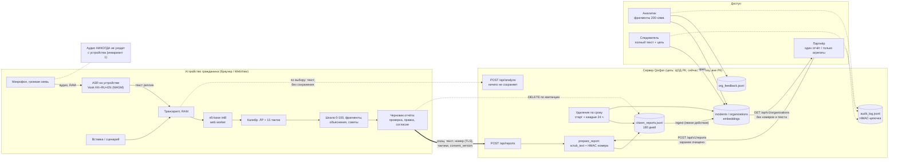
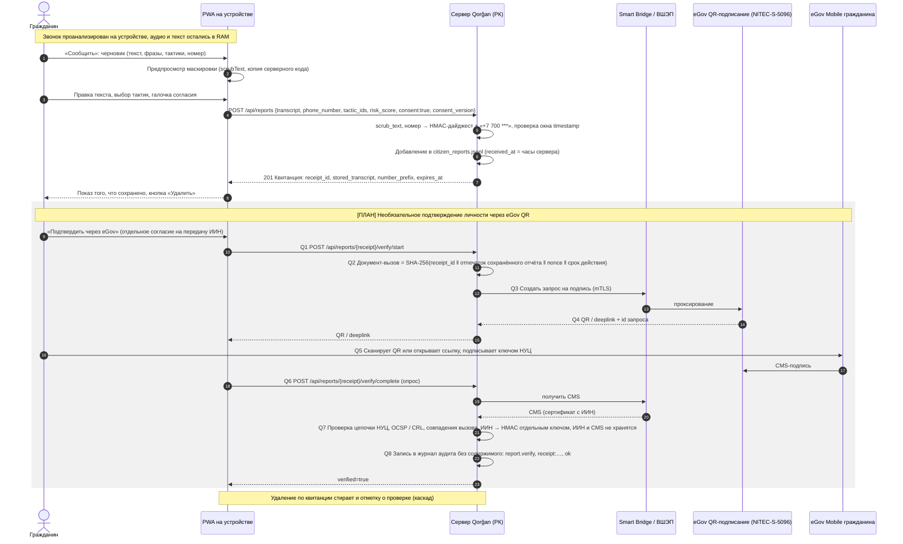

# Карта потоков данных и персональных данных (ПДн) — Qorğan

> **English summary.** This file lists every data element Qorğan touches. For each one it gives
> the source, the transformation (HMAC-SHA256 digest for caller numbers, PII scrubbing for text),
> where it is stored, how long it is kept, which role can see it, the lawful basis we propose
> (citing `docs/LEGAL_ASSESSMENT.md`, which is an engineering review, not legal advice) and
> whether it leaves Kazakhstan. Two statements are explicit and enforced by tests: **call audio
> never leaves the device**, and **`POST /api/analyze` persists nothing**. A Mermaid data-flow
> diagram and a sequence diagram for a consented report with eGov QR signing follow. The QR step
> is **planned, not built**. Known gaps are flagged with their `LEGAL_ASSESSMENT` §6 ids:
> spoken-word numbers escape the scrubber (M7), the demo is hosted outside Kazakhstan (M5), and
> there is no retention period for the audit log or analyst feedback (M4).

_Сверено с кодом ветки `sanzh-ts` @ `54a6f0b`, 2026-10-08. Номера потоков F1–F15 совпадают с
таблицей `docs/LEGAL_ASSESSMENT.md` §1. Там, где код изменился после 2026-09-25, это указано._

## 1. Два прямых заявления

1. **Аудио разговора никогда не покидает устройство.** [ФАКТ]
   - Распознавание речи идёт в браузере (`site/core/asr.js`, Vosklet WASM).
   - Сервер не принимает аудио: нет WebSocket-маршрутов и нет тел запросов `audio/*` или
     `multipart`. Серверный модуль потокового распознавания не подключён. Модуль распознавания в
     браузере не делает сетевых вызовов.
   - Всё это проверяют тесты `tests/test_architecture.py`: `test_no_websocket_routes`,
     `test_no_route_accepts_audio_or_multipart_bodies`,
     `test_no_server_side_streaming_asr_module_is_wired`,
     `test_on_device_asr_module_makes_no_network_calls`,
     `test_site_ships_no_server_streaming_microphone_client`.
2. **`POST /api/analyze` ничего не сохраняет.** [ФАКТ]
   - Вызов идёт с `use_cache=False` (`src/qorgan/api.py::analyze`).
   - Тест `test_analyze_endpoint_writes_nothing_under_data` сравнивает снимок `data/` до и после
     запроса.
   - Облачный бэкенд по этому маршруту выключен (`QORGAN_CLOUD_TIER=off`, ответ 403). При
     включённом бэкенде нужен `cloud_consent=true`, и кэш не пишется (`src/qorgan/cloud_tier.py`,
     ADR D49).

## 2. Таблица элементов данных

**Сокращения.**
- «Гр.» — гражданин; «Зв.» — звонящий (другая сторона разговора).
- Роли: A — `analyst`, I — `investigator`, P — партнёр.
- Основания — по `docs/LEGAL_ASSESSMENT.md` §2.2. Закон о ПДн № 94-V: https://adilet.zan.kz/rus/docs/Z1300000094 .
- **Трансграничность** считается для **целевого** развёртывания в РК. Для текущего демо на
  Railway **все серверные строки находятся вне РК** ([ПРОБЕЛ] M5).

### 2.1 На устройстве (Уровень 1)

| # | Элемент | Чьи данные | Источник | Преобразование | Хранение | Срок | Доступ | Основание | Трансгр. |
|---|---|---|---|---|---|---|---|---|---|
| D1 (F1) | Аудио с микрофона (громкая связь) | Гр., Зв. | микрофон, `getUserMedia` | Распознаётся в текст на устройстве; аудио не записывается | RAM браузера | на время звонка | только пользователь | Исключение для личных и семейных нужд, пп. 1 п. 3 ст. 3 [I] (§2.2 F1–F2) | нет |
| D2 (F2) | Живой транскрипт, реплики | Гр., Зв. | D1 или вставка / сценарий | Нормализация, скользящее окно «голова + хвост» | RAM (`site/live.js`, `site/core/session.js`) | до сброса или закрытия страницы | пользователь | то же | нет |
| D3 | Эмбеддинги (768-d), признаки сигналов, оценка, тактики, фрагменты, совет | Гр., Зв. (производные) | D2 | e5-base int8 → логистическая регрессия (`site/core/`) | RAM | то же | пользователь | то же | нет |
| D4 | Выбор языка интерфейса | — | пользователь | — | `localStorage` (`site/i18n-dom.js`) | бессрочно, в браузере | пользователь | не ПДн | нет |
| D5 (F3) | Загрузка модели, конфигурации и WASM | IP Гр. | GET со своего origin (`site/models/`, `/vendor/`) | — | — | — | хостинг | — | нет при хостинге в РК |
| D5a (F3) | Шрифты Google Fonts | **IP Гр.** | `site/*.html` → fonts.googleapis.com | — | у Google | по правилам Google | Google | не заявлено | **да** ([ПРОБЕЛ] S1: среда выполнения embedder уже у нас, ADR D61; шрифты ещё нет) |

### 2.2 Транзит без хранения

| # | Элемент | Чьи данные | Источник | Преобразование | Хранение | Срок | Доступ | Основание | Трансгр. |
|---|---|---|---|---|---|---|---|---|---|
| D6 (F4) | Текст для `POST /api/analyze` (≤ 20 000 символов) | Гр., Зв. | `site/try.js::analyzeOnServer`, только по выбору пользователя | Оценка в памяти | **нигде** (инвариант 2) | время запроса | процесс сервера | Согласие отметкой «оценить на сервере», сервер в РК [I] (§2.2 F4) | нет при хостинге в РК |
| D7 (F4b/F13) | Тот же текст в облачный бэкенд `llm` (Gemini) | Гр., Зв. | `/api/analyze?backend=llm` | — | у Google (журналы злоупотреблений) | по правилам Google | Google | **Не решено** ([ПРОБЕЛ] M1, M8). [ФАКТ] выключено по умолчанию, при включении нужно согласие на каждый запрос, аналитикам запрещено (`cloud_tier.py`) | **да**, поэтому `off` |
| D8 | Сырой номер звонящего в теле `POST /api/reports` / `/api/v1/reports` | Зв. | поле `phone_number` (≤ 32 символов) | Сразу → D11. Ошибки 422 **не повторяют** введённое значение | **не сохраняется** (`StoredReport` принимает только дайджест) | время запроса | — | как D9 | нет |
| D9a | IP клиента для ограничения частоты | Гр. / P | `request.client.host` | ключ скользящего окна (20/мин для отчётов, 10/мин для неверных ключей) | RAM (`src/qorgan/api_ratelimit.py`) | ≤ 60 с | процесс | Защита сервиса, ст. 22 [I] | нет |

### 2.3 На сервере (Уровень 2)

| # | Элемент | Чьи данные | Источник | Преобразование | Хранение | Срок | Доступ | Основание | Трансгр. |
|---|---|---|---|---|---|---|---|---|---|
| D9 (F6) | Текст отчёта гражданина | Гр. (возможны имя, ИИН) и **Зв.** | `POST /api/reports` после проверки и правки на устройстве | `scrub_text`: телефоны, карты, ИИН, e-mail → `[PHONE]`, `[CARD]`, `[IIN]`, `[EMAIL]`. Схема `StoredReport` отклоняет неочищенный текст (`src/qorgan/reports/model.py`). **Не маскируются:** имена, адреса, IBAN, **числа словами** ([ПРОБЕЛ] M7) | `data/processed/citizen_reports.jsonl`, JSONL, права 0640 | **180 дней от `received_at`**, удаление при старте и каждые 24 ч (`reports/purge.py`) | A — фрагмент 200 символов; I — полный текст с целью и журналом | Своё: согласие, ст. 7(1), 8(1); доказательство — `consent_version` (§2.2 F6). **Звонящего: п. 5 ст. 9 [I], не проверено — [ПРОБЕЛ] M1** | нет при хостинге в РК |
| D10 | Отмеченные фразы (≤ 50 по ≤ 300 символов) | Зв. | клиент | Сохраняются только фразы, которые дословно остались в очищенном тексте | то же | то же | A (только внутри фрагмента), I | как D9 | нет |
| D11 (F6) | Номер звонящего: `number_hash` + `number_prefix` | Зв. | D8 | **HMAC-SHA256** с ключом `QORGAN_NUMBER_HMAC_KEY`, первые 24 hex (96 бит) после нормализации; префикс `+7 700 ***`. Без ключа — 503, номер не сохраняется (`src/qorgan/privacy/numbers.py`) | то же + `incidents.jsonl`, `organizations.jsonl` | то же | A, I видят дайджесты и префиксы. **Поиска по номеру нет** (поиск в консоли — подстрока по дайджестам, `site/admin.js`) | **Псевдонимизированные ПДн, а не анонимизированные** [I] (§2.3): ключ позволяет перебрать всё пространство номеров РК | нет |
| D12 | Тактики (из 15), риск 0–100 | производные | клиент (проверены по таксономии) | — | то же | то же | A, I; P — только агрегаты | как D9 | нет |
| D13 | `timestamp` (по часам клиента) и `received_at` (по часам сервера) | Гр. | клиент / сервер | `timestamp` принимается только в окне [−180 дн, +5 мин] (`reports/retention.py`) | то же | то же | A, I | как D9 | нет |
| D14 | `consent_version`, `consent_basis` | Гр. | клиент | Версия должна быть зарегистрирована. Для `report-v1` хранится SHA-256 точной формулировки на всех языках (`CITIZEN_CONSENT_VERSIONS`) | то же | то же | A, I | Доказательство согласия, п. 2(5) ст. 25 [S] | нет |
| D15 | `receipt_id` (24 hex, 96 бит, `secrets.token_hex`) | Гр. | сервер | — | то же; показывается гражданину один раз | то же | у гражданина — право удалить | — | нет. [ПРОБЕЛ] S2: квитанция нигде не сохраняется у гражданина, `GET` по ней нет |
| D16 (F9) | Отчёт партнёра: `partner_id`, `partner_reference`, `consent_basis`, тактики, текст (по желанию, **очищенный заранее**), номер | клиенты партнёра, Зв. | `POST /api/v1/reports` | Неочищенный текст **отклоняется** (422), а не чистится молча; номер → D11 | тот же файл, `source=partner` | 180 дней | A, I; удалить может только сам партнёр | Основание партнёра + DPA ([ПРОБЕЛ] M10: `consent_basis` проверяется только по формату, без сверки с договором) | нет |
| D17 (F7) | Инциденты, организации, эмбеддинги отчётов | производные D9–D16 | `POST /api/admin/ingest` (явное действие) | Кластеризация по общим дайджестам (`analytics/numbers.py`) | `incidents.jsonl`, `organizations.jsonl`, `incident_embeddings.npz` | Удаляются каскадом вместе с отчётом (`analytics/intake.py::forget_report`) | A, I | как D9 | нет |
| D18 (F8) | Отзывы аналитиков: confirm / dismiss / merge, снимок **дайджестов** организации, id аналитика, заметка | Зв. (дайджесты), аналитик | `POST .../feedback` | Заметка без содержимого (`scrub_text` не должен ничего менять) | `org_feedback.jsonl` | [ФАКТ] При удалении отчёта его следы стираются (`forget_in_feedback`, ADR D49). **Отдельного срока хранения нет** ([ПРОБЕЛ] M4, часть) | A, I | Следует за D9 | нет |
| D19 (F11) | Журнал аудита: время, тип и id субъекта действия, действие, объект (`receipt:…`, `incident:…`, `org:…`), исход, код цели | аналитики, партнёры | все действия консоли и партнёрского API | Схема **запрещает содержимое**: `scrub_text` должен ничего не менять в каждом поле (`src/qorgan/audit.py`). HMAC-цепочка (`QORGAN_AUDIT_CHAIN_KEY`) | `audit_log.jsonl` | **Не установлен** ([ПРОБЕЛ] M4). [ПРЕДЛОЖЕНИЕ] 3 года по п. 49 ЕТ [A] | оператор системы; проверка — `python -m qorgan.audit verify` | Журнал безопасности, ст. 22 [I] | нет |
| D20 (F12) | Журнал доступа HTTP (IP, путь, а путь содержит квитанцию) | Гр. | uvicorn | — | [ФАКТ] **выключен** в Docker (`UVICORN_ACCESS_LOG=false`, `docs/DEPLOY.md` §1); на Railway — журналы платформы | — | хостинг | — | Railway: **вне РК** |
| D21 | Ключ аналитика в браузере | аналитик | ввод | — | `sessionStorage`, только эта вкладка (`site/admin.js`) | до закрытия вкладки | аналитик | — | нет |
| D22 (F15) | Секреты: `QORGAN_NUMBER_HMAC_KEY`, `QORGAN_AUDIT_CHAIN_KEY`, `QORGAN_ANALYST_KEYS`, `QORGAN_PARTNER_API_KEYS`, `GEMINI_API_KEY` | — | оператор системы | Конфигурация отклоняет слабые и повторяющиеся секреты (`analysts.py`, `partners.py`) | `.env` только для чтения или переменные платформы; в образ не попадают (`Dockerfile`, `docs/DEPLOY.md` §1) | до ротации | оператор системы | — | Railway: вне РК. [ПРЕДЛОЖЕНИЕ] Хранилище секретов под контролем РК (`DEPLOY.md` §7(5)) |
| D23 (F14) | Данные для обучения и оценки | синтетические | генерация (Gemini, Claude) | `scrub_text`, проверка перед публикацией (ADR D45/D50) | `data/processed/*.jsonl`; публично на HF `sanzh-ts/govtech_ds` | бессрочно | публично | Синтетика основания не требует. **Реальные звонки** — по `docs/DATA_INTAKE.md`, основание открыто (§9) | HF — вне РК, только синтетика. [ПРОБЕЛ] M11: копия на Hub ещё содержит один синтетический ИИН |

### 2.4 Планируемые элементы ([ПРЕДЛОЖЕНИЕ], не реализовано)

| # | Элемент | Источник | Предлагаемое преобразование | Хранение | Срок | Основание | Трансгр. |
|---|---|---|---|---|---|---|---|
| P1 | **ИИН гражданина** из сертификата НУЦ в подписи eGov QR (CMS) | NITEC-S-5096 [A] (https://sb.egov.kz/services/passport/NITEC-S-5096 ) | Проверить подпись → взять ИИН из сертификата → хранить **только** `signer_verified=true`, время проверки и `iin_digest` (HMAC отдельным ключом, только для защиты от злоупотреблений и лимита). Сам ИИН и CMS **не хранить**, если получатель передачи не требует иного | рядом с отчётом | как у отчёта | Явное согласие гражданина. Отчёт с ИИН — ПДн гражданина: локализация, маскирование, удаление по требованию [A/B] (https://profit.kz/news/74963/ ; egov_integration §3). Если система государственная — согласие, возможно, через госсервис (п. 1 ст. 8, абз. 2) [I] (`LEGAL_ASSESSMENT` §2.4) | нет |
| P2 | Жалоба оператору (с открытым номером) | устройство гражданина | Формируется **на устройстве** и уходит прямо в канал оператора. **Сервер Qorğan открытый номер не получает** | у получателя | по правилам получателя | Жалоба абонента, приказ от 18.11.2025 [B] | нет |
| P3 | Сигнал участнику Антифрод-центра (дайджест, тактики, фрагменты) | сервер Qorğan после проверки аналитиком | Только из отчётов, где гражданин согласился на передачу третьему лицу (**в текущий текст согласия такого пункта нет**) | у получателя | — | Передача третьему лицу требует согласия, п. 6 ст. 7 [S]; DPA (M10) | нет |

## 3. Диаграмма потоков данных

## 4. Последовательность: отчёт с согласием и подписью eGov QR

> **QR-подписание — [ПЛАН / ПРЕДЛОЖЕНИЕ], не реализовано.** Шаги 1–9 — [ФАКТ] (текущий поток,
> `site/live.js::sendReport`, `src/qorgan/api_reports.py`). Шаги Q1–Q8 — наш проект. Публичного
> описания протокола NITEC-S-5096 мы не нашли: карточку прочитали по сниппету поиска [A]. Поэтому
> формат вызова и ответа нужно уточнить у НИТ (вопрос 5). Временная альтернатива — SIGEX [B]
> (https://github.com/sigex-kz/sigex-qr-signing-client ).

## 5. Что требует решения до пилота

| # | Вопрос | Ссылка |
|---|---|---|
| 1 | Основание для обработки данных звонящего и нужен ли «режим по умолчанию: только тактики и фразы, текст — по желанию» | M1, `LEGAL_ASSESSMENT` §2.2 |
| 2 | Полный текст согласия с пунктами п. 4 ст. 8 (оператор, БИН, срок, третьи лица, трансграничность, перечень данных). Сейчас `report-v1` — одна строка: «Я проверил(а) сообщение и согласен(на) его отправить» (`site/i18n.js`). Черновики RU/KK — в `LEGAL_ASSESSMENT` §7.1 | M3 |
| 3 | Маскировка чисел, произнесённых словами («восемь семьсот…») — именно в таком виде их пишет распознавание на устройстве | M7 |
| 4 | Сроки хранения журнала аудита, отзывов аналитиков и журналов платформы | M4 |
| 5 | Отдельный пункт согласия на передачу оператору / участнику Антифрод-центра (P2/P3). Без него передача третьему лицу незаконна (п. 6 ст. 7) [S] | M10, N1 |
| 6 | Класс оператора по размеру и уведомление по ст. 10-1 при более чем 10 000 субъектов | M6 |
